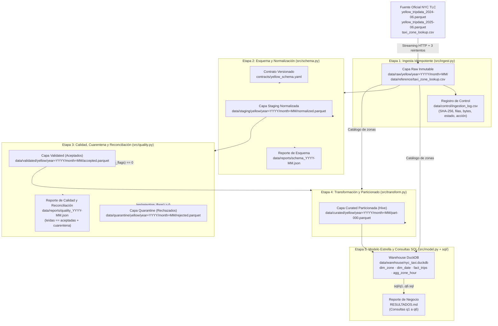
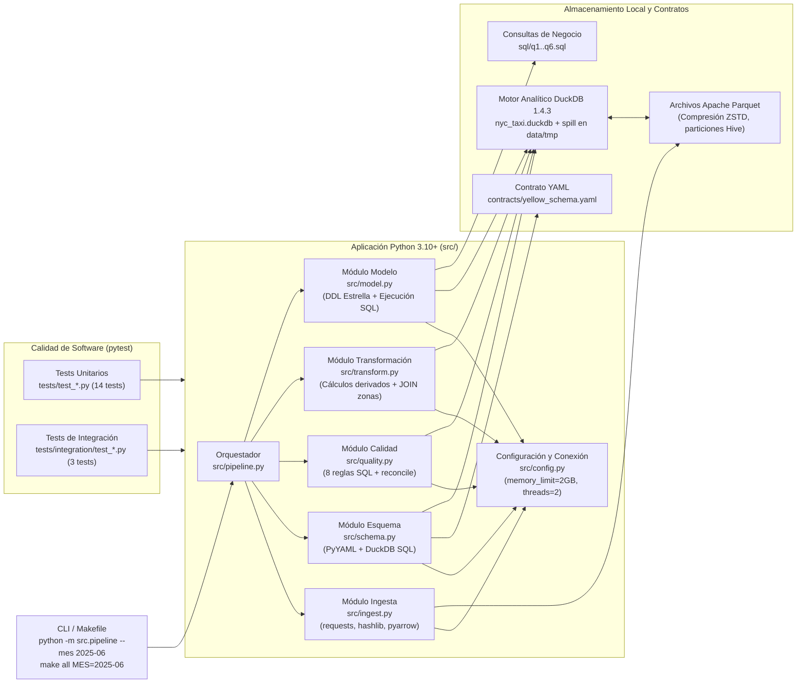
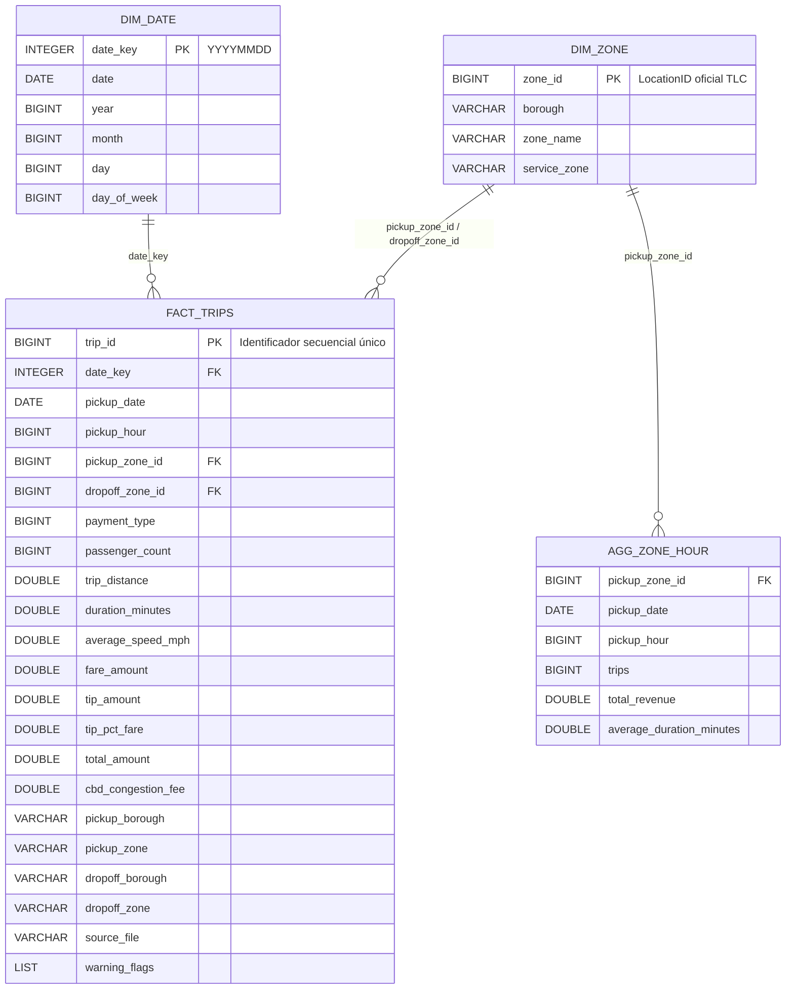

# Pipeline Batch NYC Taxi — Ingeniería de Datos (`2024-06` vs `2025-06`)

**Materia:** Fundamentos de Datos · Ingeniería en Sistemas de Información (4.° Año — UTN FRT)  
**Trabajo Práctico / Examen Parcial:** Pipeline Batch Reproducible NYC TLC Yellow Taxi  
**Repositorio:** `examen_Taxis`  
**Integrantes y distribución del desarrollo:**
- **Integrante 1 (Víctor Manuel Libran — Parte A: Ingesta, Esquema, Calidad y Orquestación):** módulos [`src/config.py`](src/config.py), [`src/ingest.py`](src/ingest.py), [`src/schema.py`](src/schema.py), [`src/quality.py`](src/quality.py), [`src/pipeline.py`](src/pipeline.py), contrato [`contracts/yellow_schema.yaml`](contracts/yellow_schema.yaml) y suite de pruebas unitarias.
- **Integrante 2 (Compañero de equipo — Parte B: Transformación, Modelo Dimensional, Consultas SQL y Auditoría de Integración):** módulos [`src/transform.py`](src/transform.py), [`src/model.py`](src/model.py), consultas [`sql/`](sql/), reporte [`RESULTADOS.md`](RESULTADOS.md) y pruebas de integración en [`tests/integration/`](tests/integration/).

---

## Tabla de Contenidos

1. [Problema, Objetivo y Alcance](#1-problema-objetivo-y-alcance)
2. [Fuente Oficial NYC TLC y Justificación del Período (`2024-06` vs `2025-06`)](#2-fuente-oficial-nyc-tlc-y-justificación-del-período-2024-06-vs-2025-06)
3. [Arquitectura General del Sistema](#3-arquitectura-general-del-sistema)
4. [Diagrama del Flujo de Datos (5 Etapas)](#4-diagrama-del-flujo-de-datos-5-etapas)
5. [Diagrama de Herramientas y Componentes](#5-diagrama-de-herramientas-y-componentes)
6. [Explicación Detallada de las Cinco Etapas](#6-explicación-detallada-de-las-cinco-etapas)
7. [Justificación Tecnológica (Stack Implementado)](#7-justificación-tecnológica-stack-implementado)
8. [Modelo Estrella y Tabla Agregada en DuckDB](#8-modelo-estrella-y-tabla-agregada-en-duckdb)
9. [Reglas de Calidad, Cuarentena y Reconciliación Exacta](#9-reglas-de-calidad-cuarentena-y-reconciliación-exacta)
10. [Las Seis Preguntas de Negocio](#10-las-seis-preguntas-de-negocio)
11. [Resultados Reales y Hallazgos Principales](#11-resultados-reales-y-hallazgos-principales)
12. [Estructura del Repositorio](#12-estructura-del-repositorio)
13. [Instalación, Tests y Ejecución en PowerShell](#13-instalación-tests-y-ejecución-en-powershell)
14. [Arquitectura Reproducible con Recursos Limitados (8 GB RAM)](#14-arquitectura-reproducible-con-recursos-limitados-8-gb-ram)
15. [Tiempo de Ejecución y Memoria Verificados](#15-tiempo-de-ejecución-y-memoria-verificados)
16. [Limitaciones Conocidas](#16-limitaciones-conocidas)
17. [Declaración de Uso de Inteligencia Artificial (Codex y Antigravity)](#17-declaración-de-uso-de-inteligencia-artificial-codex-y-antigravity)
18. [Documentación Complementaria del Proyecto](#18-documentación-complementaria-del-proyecto)

---

## 1. Problema, Objetivo y Alcance

### Problema
Los registros públicos de viajes de taxis amarillos de Nueva York presentan tres desafíos clásicos de Ingeniería de Datos:
1. **Volumen elevado para equipos portátiles:** dos meses acumulan **7.862.153 filas**, lo que vuelve inviable cargar los datasets completos en memoria mediante estructuras tradicionales como DataFrames de `pandas` en una computadora con límite de **8 GB de RAM**.
2. **Evolución de esquema entre años (*schema drift*):** a partir de 2025 la fuente oficial incorporó la columna `cbd_congestion_fee` (peaje de congestión del distrito central de Manhattan), ausente en los archivos de 2024.
3. **Datos crudos con anomalías operativas:** existen viajes con fechas fuera del mes del archivo, tiempos de bajada anteriores o iguales a la subida, distancias nulas, cero o extremas (> 200.000 millas), importes totales negativos, cantidades de pasajeros nulas o cero y propinas negativas.

### Objetivo
Construir un **pipeline batch local, idempotente, trazable y reproducible** que ejecute de punta a punta con un único comando (`python -m src.pipeline --mes 2025-06` o `make all MES=2025-06`) las cinco etapas del ciclo de datos: ingesta con control de hashes, normalización bajo contrato versionado, validación de calidad con cuarentena y reconciliación estricta, almacenamiento Parquet particionado estilo Hive y modelado dimensional en estrella para responder seis consultas analíticas en SQL.

### Alcance
- Procesamiento automático del mes asignado (`2025-06`) y su mes homólogo del año anterior (`2024-06`), más el catálogo oficial de zonas (`taxi_zone_lookup.csv`).
- Cobertura completa de las 5 etapas exigidas en la consigna y validación automatizada con **17 pruebas en `pytest`** (unitarias y de integración extremo a extremo con datos sintéticos).
- Exclusión estricta de archivos de datos (`data/`) y entornos locales (`.venv/`) del control de versiones en Git.

---

## 2. Fuente Oficial NYC TLC y Justificación del Período (`2024-06` vs `2025-06`)

Los datos provienen del portal público de la **New York City Taxi and Limousine Commission (NYC TLC Trip Record Data)**, distribuidos a través de su CDN oficial:
- **Viajes mensuales (Parquet):** `https://d37ci6vzurychx.cloudfront.net/trip-data/yellow_tripdata_YYYY-MM.parquet`
- **Catálogo de zonas (CSV):** `https://d37ci6vzurychx.cloudfront.net/misc/taxi_zone_lookup.csv`

### ¿Por qué comparar junio de 2024 contra junio de 2025?
1. **Control de estacionalidad:** comparar el mismo mes calendario (`06`) en dos años consecutivos evita sesgos climáticos o vacacionales propios de contrastar meses de distintas estaciones.
2. **Cambio regulatorio y estructural de esquema:** el peaje de congestión en Manhattan (*Central Business District Congestion Fee*) entró en vigor en 2025. Comparar `2024-06` (19 columnas, sin `cbd_congestion_fee`) contra `2025-06` (20 columnas, con `cbd_congestion_fee`) obliga al pipeline a resolver un caso real de evolución de esquema y permite medir la incidencia del nuevo cargo sobre los viajes aceptados.
3. **Magnitud representativa:** entre ambos períodos se procesan **7.862.153 registros crudos** (~133,4 MB comprimidos en Parquet), de los cuales **7.493.698 viajes** superan las compuertas de calidad y **368.455** se derivan a cuarentena.

| Archivo oficial descargado | Período | Filas crudas | Tamaño en disco | Hash SHA-256 verificado |
|---|---|---:|---:|---|
| `yellow_tripdata_2024-06.parquet` | `2024-06` | 3.539.193 | 59.859.922 B | `677cf14c8347f745b583f012fbdba072334c6c4efa17bfd6a64369f2ba30329c` |
| `yellow_tripdata_2025-06.parquet` | `2025-06` | 4.322.960 | 73.542.954 B | `1bea7f5b09c744414451fa7fef09fbc5a393ffb1621c859be6ba0df23a14e1b6` |
| `taxi_zone_lookup.csv` | Catálogo | 265 | 12.331 B | `1a99e105092230f8620f301edcca7f80d3080642ff404d28ed957d3fa222c8ed` |

---

## 3. Arquitectura General del Sistema

El proyecto sigue una **arquitectura multicapa sobre almacenamiento columnar Parquet y motor analítico embebido DuckDB**, orquestada desde Python mediante funciones puras con contratos de entrada/salida tipados (`Path`).

Cada capa tiene una responsabilidad única y escribe sus salidas de manera atómica (a través de archivos temporales `.part` o `.tmp` que luego reemplazan al destino), garantizando que una interrupción nunca deje artefactos corruptos ni datos duplicados:

1. **Capa `raw` (`data/raw/` y `data/reference/`):** inmutable. Conserva exactamente los bytes descargados de NYC TLC y audita cada operación en `data/control/ingestion_log.csv`.
2. **Capa `staging` (`data/staging/`):** esquema validado y normalizado a `snake_case` según [`contracts/yellow_schema.yaml`](contracts/yellow_schema.yaml), unificando diferencias entre 2024 y 2025.
3. **Capas `validated` y `quarantine` (`data/validated/` y `data/quarantine/`):** compuerta de calidad que clasifica cada fila una sola vez. Separa viajes aceptados (con `warning_flags`) de viajes rechazados (con `violated_rules` y `rejection_flags`) y verifica la reconciliación matemática de conteos.
4. **Capa `curated` (`data/curated/`):** almacenamiento Parquet particionado por `year=YYYY/month=MM`, enriquecido con métricas derivadas y atributos geográficos de zonas.
5. **Capa `warehouse` (`data/warehouse/nyc_taxi.duckdb`):** base de datos analítica con el modelo estrella (`fact_trips`, `dim_zone`, `dim_date`) y la tabla agregada (`agg_zone_hour`), sobre la cual se ejecutan las 6 consultas SQL de [`sql/`](sql/) que generan [`RESULTADOS.md`](RESULTADOS.md).

Para un análisis comparativo entre la arquitectura implementada y la arquitectura objetivo de evolución (con dbt y contenedores Docker), véase [`docs/ARQUITECTURA.md`](docs/ARQUITECTURA.md).

---

## 4. Diagrama del Flujo de Datos (5 Etapas)



---

## 5. Diagrama de Herramientas y Componentes



---

## 6. Explicación Detallada de las Cinco Etapas

### Etapa 1: Ingesta idempotente y registro de control (`src/ingest.py`)
- **Función:** `run_ingest(month: str) -> Path`
- **Comportamiento:** descarga el archivo mensual a `data/raw/yellow/year=YYYY/month=MM/yellow_tripdata_YYYY-MM.parquet` sin alterar un solo byte, y el catálogo de zonas a `data/reference/taxi_zone_lookup.csv`.
- **Tolerancia a fallos y atomicidad:** utiliza descargas por *streaming* en bloques de 1 MiB hacia un archivo temporal `.part`. Ante errores de red (`requests.RequestException`), aplica hasta **3 reintentos con espera exponencial creciente** (`1 s`, `2 s` y `4 s`). Antes de promover el archivo `.part` a su nombre definitivo, verifica que el Parquet tenga metadatos válidos con PyArrow o que el CSV de zonas contenga las columnas `LocationID`, `Borough` y `Zone` con filas válidas. Si todos los intentos fallan, elimina el archivo parcial `.part`, registra el evento con `status="error"` en el log y termina con código de salida distinto de cero.
- **Idempotencia por hash SHA-256:** calcula el resumen criptográfico SHA-256 del archivo y lo contrasta con el último estado `ok` en `data/control/ingestion_log.csv`. Si el archivo local existe y el hash coincide, lo reutiliza (`action="reused"`) sin realizar peticiones HTTP ni duplicar datos. Si el archivo fue modificado externamente y el hash difiere del histórico, aborta la ejecución para proteger la trazabilidad.

### Etapa 2: Normalización y validación de esquema (`src/schema.py`)
- **Función:** `run_schema(month: str, raw_path: Path) -> Path`
- **Contrato explícito:** lee [`contracts/yellow_schema.yaml`](contracts/yellow_schema.yaml) (versión 1), que define las 20 columnas esperadas, su nombre normalizado en `snake_case` (por ejemplo, `VendorID` $\rightarrow$ `vendor_id`, `PULocationID` $\rightarrow$ `pu_location_id`, `DOLocationID` $\rightarrow$ `do_location_id`, `RatecodeID` $\rightarrow$ `ratecode_id`, `Airport_fee` $\rightarrow$ `airport_fee`) y su tipo de datos destino en DuckDB (`BIGINT`, `TIMESTAMP`, `DOUBLE`, `VARCHAR`).
- **Comparación previa y política de evolución:** antes de materializar la capa *staging*, inspecciona el esquema real del Parquet mediante `DESCRIBE` y genera `data/reports/schema_YYYY-MM.json` detallando esquema observado, columnas faltantes, columnas nuevas y diferencias de tipos:
  - **`cbd_congestion_fee` en 2024:** el contrato establece la política `fail_except_cbd_before_2025`. Para meses anteriores a 2025 se permite únicamente la ausencia de `cbd_congestion_fee` y se proyecta como `CAST(NULL AS DOUBLE)`. Se eligió `NULL` en lugar de `0.0` porque en junio de 2024 el peaje no existía legalmente; asignar cero mezclaría la inexistencia histórica del cargo con viajes realizados durante 2025 que estuvieron exentos del recargo. En 2025 la columna es obligatoria.
  - **Política ante columnas nuevas (`fail_and_report`):** si mañana la TLC agrega una columna no declarada en el YAML, el pipeline escribe el diagnóstico en `schema_YYYY-MM.json` y detiene la ejecución lanzando un `ValueError`. No se descartan columnas silenciosamente; cualquier cambio estructural exige revisar y versionar el contrato.
  - **Conversiones de tipos sin pérdida:** sólo se autoriza ampliar enteros menores (`TINYINT`, `SMALLINT`, `INTEGER`) a `BIGINT` (como ocurre con `VendorID`, `PULocationID` y `DOLocationID`). No se utiliza `TRY_CAST` para evitar ocultar datos corruptos bajo nulos silenciosos.
- **Salida:** escribe `data/staging/yellow/year=YYYY/month=MM/normalized.parquet` añadiendo la columna de linaje `source_file`.

### Etapa 3: Calidad de datos, cuarentena y reconciliación (`src/quality.py`)
- **Función:** `run_quality(month: str, staged_path: Path) -> Path`
- **Clasificación única en una sola pasada:** evalúa las 8 reglas de calidad (`R01` a `R08`) simultáneamente en DuckDB sobre la vista `staged` y numera repeticiones exactas mediante `row_number() OVER (PARTITION BY <columnas_del_viaje>) AS _occurrence`.
- **Separación por severidad:**
  - Las filas sin banderas de rechazo (`len(rejection_flags) == 0`) van a `data/validated/yellow/year=YYYY/month=MM/accepted.parquet`, conservando las 20 columnas del contrato, `source_file` y `warning_flags` (`LIST<VARCHAR>`).
  - Las filas que violan al menos una regla de rechazo (`len(rejection_flags) > 0`) van a `data/quarantine/yellow/year=YYYY/month=MM/rejected.parquet`, conservando todos los valores originales normalizados más `source_file`, `violated_rules`, `rejection_flags` y `warning_flags`. Una fila que incumple múltiples reglas de rechazo se escribe **una sola vez** en cuarentena con la lista completa de reglas infringidas.
- **Doble reconciliación:** verifica `rows_read == rows_accepted + rows_quarantined` tanto sobre la tabla clasificada como volviendo a contar los archivos Parquet físicos recién escritos en disco, y emite `data/reports/quality_YYYY-MM.json`.

### Etapa 4: Transformación y almacenamiento particionado (`src/transform.py`)
- **Función:** `run_transform(month: str, validated_path: Path) -> Path`
- **Columnas derivadas y enriquecimiento geográfico:** toma `accepted.parquet`, realiza dos `LEFT JOIN` contra el catálogo de zonas (origen y destino) y calcula:
  - `duration_minutes`: duración del viaje en minutos con precisión decimal (`date_diff('second', pickup, dropoff) / 60.0`).
  - `average_speed_mph`: velocidad media en millas por hora cuando distancia y duración son positivas.
  - `pickup_date`, `pickup_hour`, `pickup_day_of_week`: fecha (`DATE`), hora (`0..23`) y día de la semana (`0..6`) de la subida.
  - `tip_pct_fare`: propina como porcentaje de la tarifa base (`100.0 * tip_amount / fare_amount` cuando `fare_amount > 0`; `NULL` cuando `fare_amount <= 0` para evitar divisiones por cero o cocientes distorsionados).
  - `pickup_borough`, `pickup_zone`, `pickup_service_zone`, `dropoff_borough`, `dropoff_zone`, `dropoff_service_zone`.
- **Particionado estilo Hive y aislamiento:** escribe en `data/curated/yellow/year=YYYY/month=MM/part-000.parquet` con compresión `ZSTD`. Reprocesar un mes reemplaza de forma atómica únicamente el archivo de esa partición y deja intactas las particiones de los demás meses.

### Etapa 5: Modelo estrella, agregados y consultas de negocio (`src/model.py` y `sql/`)
- **Función:** `run_model(months: list[str]) -> None`
- **Construcción del Warehouse:** conecta a `data/warehouse/nyc_taxi.duckdb`, crea una vista temporal `_curated` sobre las particiones curadas de ambos meses y materializa con `CREATE OR REPLACE TABLE` las tablas `dim_zone`, `dim_date`, `fact_trips`, `agg_zone_hour` y `analysis_parameters`.
- **Generación reproducible de resultados:** ejecuta en orden alfabético los seis archivos SQL de [`sql/`](sql/) (`q1_top_zones.sql` a `q6_month_variation.sql`) y escribe las consultas, las tablas formateadas en Markdown y sus interpretaciones técnicas en [`RESULTADOS.md`](RESULTADOS.md).

---

## 7. Justificación Tecnológica (Stack Implementado)

El proyecto utiliza exclusivamente tecnologías implementadas y verificadas en el repositorio ([`requirements.txt`](requirements.txt)):

| Tecnología | Versión fijada | Rol en el pipeline y justificación de ingeniería |
|---|---|---|
| **Python** | `3.10+` (verificado en `3.12.16`) | Lenguaje de orquestación, manejo de descargas HTTP en streaming, cálculo incremental de hashes SHA-256, control de errores y ejecución de pruebas. |
| **DuckDB** | `1.4.3` | Motor SQL analítico columnar *in-process* (OLAP). Ejecuta consultas vectorizadas directamente sobre archivos Parquet sin levantar el dataset en memoria de Python, permite configurar un techo estricto de RAM (`memory_limit='2GB'`) y vuelca operaciones intermedias a disco (`data/tmp`). |
| **Apache Parquet + PyArrow** | `22.0.0` | Formato de almacenamiento columnar comprimido (`ZSTD`). Reduce el tamaño en disco, preserva los tipos del contrato (`TIMESTAMP`, `BIGINT`, `DOUBLE`, `LIST<VARCHAR>`) y habilita lectura rápida por proyección de columnas y particionado estilo Hive. PyArrow se emplea para validar metadatos de integridad (`num_rows`) sin escanear todos los bloques y para construir fixtures sintéticos en los tests. |
| **PyYAML** | `6.0.3` | Lectura del contrato declarativo de esquema ([`contracts/yellow_schema.yaml`](contracts/yellow_schema.yaml)), desacoplando las reglas de nombres y tipos del código Python. |
| **Requests** | `2.32.5` | Cliente HTTP con soporte de `stream=True` y *timeouts* explícitos (`(15, 120)` segundos) para descargas de archivos grandes en fragmentos de 1 MiB con reintentos exponenciales. |
| **pytest** | `9.0.2` | Framework de pruebas automatizadas para verificar reglas de calidad, idempotencia, fallas de red, evolución de esquema, aislamiento de particiones y consultas SQL sobre datos sintéticos sin depender de conexión a Internet. |

---

## 8. Modelo Estrella y Tabla Agregada en DuckDB

El warehouse analítico (`data/warehouse/nyc_taxi.duckdb`) implementa un esquema en estrella compuesto por una tabla de hechos, dos dimensiones conformadas y una tabla agregada precalculada:



### Granularidad y conteos verificados

| Tabla | Rol dimensional | Granularidad exacta | Filas en `nyc_taxi.duckdb` | Verificación de integridad |
|---|---|---|---:|---|
| `fact_trips` | Tabla de hechos | 1 fila por viaje aceptado en los dos meses procesados | **7.493.698** | `3.441.465` (`2024-06`) + `4.052.233` (`2025-06`); `trip_id` 100 % único |
| `dim_zone` | Dimensión geográfica | 1 fila por zona del catálogo oficial TLC (`LocationID`) | **265** | Incluye las 263 zonas geográficas más códigos `264` (`Unknown`) y `265` (`Outside of NYC`) |
| `dim_date` | Dimensión temporal | 1 fila por fecha calendario de subida (`pickup_date`) | **60** | 30 días de junio de 2024 + 30 días de junio de 2025 |
| `agg_zone_hour` | Tabla agregada | 1 fila por `(pickup_zone_id, pickup_date, pickup_hour)` | **210.698** | `SUM(trips) = 7.493.698` (coincide exactamente con `COUNT(*)` de `fact_trips`) |

---

## 9. Reglas de Calidad, Cuarentena y Reconciliación Exacta

Se implementaron **8 reglas explícitas** en [`src/quality.py`](src/quality.py), cada una con identificador, descripción, severidad (`reject` o `warning`), condición lógica y justificación documental.

### Catálogo de reglas y violaciones observadas en datos reales

| ID | Regla de calidad | Condición de incumplimiento | Severidad | Justificación de umbral y severidad | Violaciones `2024-06` | Violaciones `2025-06` |
|---|---|---|---|---|---:|---:|
| **R01** | Fecha de subida fuera del mes | `pickup IS NULL` o fuera de `[YYYY-MM-01, mes_siguiente)` | **Rechazo** (`reject`) | La subida define la pertenencia al período analítico; registros de otros meses contaminan la comparación interanual. | 51 | 20 |
| **R02** | Bajada anterior o igual a subida | `dropoff IS NULL` o `pickup IS NULL` o `dropoff <= pickup` | **Rechazo** (`reject`) | Todo viaje válido requiere duración estrictamente positiva (`duration_minutes > 0`). | 1.140 | 68.583 |
| **R03** | Distancia inválida o extrema | `trip_distance IS NULL`, no finita, `<= 0` o `> 200` millas | **Rechazo** (`reject`) | Cero o negativo impide calcular velocidades reales; el tope de 200 millas acota errores de taxímetro observados en la exploración (máximos de 195.916,81 mi en 2024 y 261.262,39 mi en 2025). | 53.084 | 135.118 |
| **R04** | Importe total negativo o nulo | `total_amount IS NULL`, no finito o `< 0` | **Rechazo** (`reject`) | Los importes negativos corresponden a reversos contables o contracargos que distorsionan el ingreso promedio si se mezclan con viajes cobrados. Se permite `total_amount == 0`. | 48.795 | 74.257 |
| **R05** | Pasajeros nulos o menores/iguales a cero | `passenger_count IS NULL` o `<= 0` | **Advertencia** (`warning`) | En 2025-06 afecta a 1,23 M de viajes (principalmente despachos por app / Flex Fare donde el conductor no carga pasajeros). Descartarlos eliminaría casi el 30 % del volumen real de viajes válidos en tiempo, distancia e importe. | 446.620 | 1.235.737 |
| **R06** | Zona de origen o destino inexistente | `pu_location_id` o `do_location_id` ausente en `taxi_zone_lookup.csv` | **Rechazo** (`reject`) | Garantiza integridad referencial con `dim_zone`. Los IDs 264 y 265 existen en el catálogo oficial de TLC, por lo que son válidos. | 0 | 0 |
| **R07** | Filas duplicadas exactas | `_occurrence > 1` al particionar por todas las columnas del viaje | **Rechazo** (`reject`) | Conserva la primera aparición en `accepted.parquet` y envía las copias excedentes a cuarentena para evitar inflar conteos y facturación. | 0 | 0 |
| **R08** | Propina negativa *(regla propia de exploración)* | `tip_amount < 0` | **Advertencia** (`warning`) | Descubierta explorando los datos crudos (mínimo `-$99,01` en 2024-06 y `-$70,07` en 2025-06). Cuando coexiste con `total_amount < 0` cae en cuarentena por `R04`; si el total es `>= 0`, se conserva marcada en `warning_flags`. | 108 | 367 |

> **Nota sobre superposición de reglas:** Una misma fila puede infringir simultáneamente más de una regla (por ejemplo, tener `total_amount < 0` y `trip_distance == 0`). Por eso la suma aritmética de violaciones individuales por regla (`R01..R07`) supera la cantidad de filas únicas en cuarentena.

### Reconciliación de conteos e idempotencia entre ejecuciones

El pipeline aplica una **compuerta de reconciliación obligatoria** (`reconcile(read, accepted, rejected)`): si `rows_read != rows_accepted + rows_quarantined`, lanza una excepción y aborta con código de salida `1`.

| Período | Filas Leídas (`raw` / `staging`) | Filas Aceptadas (`validated` / `curated`) | Filas en Cuarentena (`quarantine`) | % Aceptado | % Cuarentena | Estado de Reconciliación |
|---|---:|---:|---:|---:|---:|---|
| **`2024-06`** | 3.539.193 | 3.441.465 | 97.728 | 97,24 % | 2,76 % | Exacta (`3.539.193 = 3.441.465 + 97.728`) |
| **`2025-06`** | 4.322.960 | 4.052.233 | 270.727 | 93,74 % | 6,26 % | Exacta (`4.322.960 = 4.052.233 + 270.727`) |
| **Total 2 meses** | **7.862.153** | **7.493.698** | **368.455** | **95,31 %** | **4,69 %** | **Exacta (`7.862.153 = 7.493.698 + 368.455`)** |

Al ejecutar el pipeline por segunda vez consecutiva o reprocesar un único mes, los conteos de `accepted.parquet`, `rejected.parquet`, `part-000.parquet`, `fact_trips` y `agg_zone_hour` permanecen idénticos, sin duplicación de filas.

---

## 10. Las Seis Preguntas de Negocio

Las preguntas exigidas por la cátedra se resuelven mediante seis consultas SQL independientes versionadas en [`sql/`](sql/), ejecutadas directamente sobre `data/warehouse/nyc_taxi.duckdb`:

1. **[`sql/q1_top_zones.sql`](sql/q1_top_zones.sql):** Las 10 zonas de origen (`pickup_zone`) con mayor cantidad de viajes en el mes asignado (`2025-06`) y su variación porcentual contra el mismo mes de 2024 (`2024-06`).
2. **[`sql/q2_peak_revenue_hour.sql`](sql/q2_peak_revenue_hour.sql):** La hora del día (`pickup_hour`) con mayor ingreso promedio por viaje (`AVG(total_amount)`) en `2025-06`.
3. **[`sql/q3_cbd_fee.sql`](sql/q3_cbd_fee.sql):** El porcentaje de viajes con `cbd_congestion_fee > 0` en `2025-06` y las 5 zonas de origen con mayor proporción de esos viajes.
4. **[`sql/q4_tip_by_payment.sql`](sql/q4_tip_by_payment.sql):** La propina promedio como porcentaje de la tarifa (`tip_amount / fare_amount`) por tipo de pago (`payment_type`) en `2025-06`, explicando por qué ciertos tipos de pago no son interpretables como comportamiento real de propina.
5. **[`sql/q5_airports.sql`](sql/q5_airports.sql):** Cantidad de viajes y tarifa media (`AVG(fare_amount)`) de los viajes que empiezan o terminan en los aeropuertos **JFK** o **LaGuardia**, identificados por nombre de zona, comparando `2024-06` y `2025-06`.
6. **[`sql/q6_month_variation.sql`](sql/q6_month_variation.sql):** Variación absoluta y porcentual de viajes totales y de tarifa media entre `2024-06` y `2025-06`, acompañada de una hipótesis de causa en no más de 5 líneas.

---

## 11. Resultados Reales y Hallazgos Principales

A continuación se sintetizan los resultados reales obtenidos por el pipeline (el detalle completo con código SQL y tablas se encuentra en [`RESULTADOS.md`](RESULTADOS.md)):

### Q1 — Top 10 zonas de origen con más viajes (`2025-06` vs `2024-06`)

| Posición | Zona de origen (`pickup_zone`) | Viajes `2025-06` | Viajes `2024-06` | Variación interanual (%) |
|---:|---|---:|---:|---:|
| 1 | `JFK Airport` | 170.662 | 152.171 | +12,15 % |
| 2 | `Upper East Side South` | 169.820 | 156.503 | +8,51 % |
| 3 | `Midtown Center` | 168.115 | 159.330 | +5,51 % |
| 4 | `Upper East Side North` | 147.498 | 140.822 | +4,74 % |
| 5 | `Midtown East` | 122.391 | 118.073 | +3,66 % |
| 6 | `Penn Station/Madison Sq West` | 121.996 | 108.741 | +12,19 % |
| 7 | `Times Sq/Theatre District` | 121.497 | 113.406 | +7,13 % |
| 8 | `Lincoln Square East` | 109.013 | 105.089 | +3,73 % |
| 9 | `LaGuardia Airport` | 108.971 | 112.984 | -3,55 % |
| 10 | `Murray Hill` | 108.388 | 101.329 | +6,97 % |

### Q2 — Hora del día con mayor ingreso promedio por viaje (`2025-06`)
- **Hora pico en ingreso unitario:** **`05:00` h** (`pickup_hour = 5`), con **`33.314` viajes**, un ingreso acumulado de **`$1.085.064,60`** y un ingreso promedio de **`$32,5708` por viaje**.
- **Interpretación:** esta métrica maximiza el ticket medio por viaje (no la facturación total agregada del día, que se concentra en horario vespertino). La consulta agrupa exclusivamente por hora de subida.

### Q3 — Incidencia del cargo por congestión (`cbd_congestion_fee > 0` en `2025-06`)
- **Proporción global:** sobre `4.052.233` viajes aceptados en junio de 2025, **`2.987.770` viajes** (**`73,7314 %`**) registraron `cbd_congestion_fee > 0`.
- **Top 5 zonas de origen por proporción:**
  1. `Rikers Island`: 1 de 1 viaje (`100,0000 %` — caso extremo de bajo volumen: un único viaje en el mes).
  2. `Greenwich Village South`: 56.670 de 56.778 viajes (`99,8098 %`).
  3. `West Village`: 87.904 de 88.077 viajes (`99,8036 %`).
  4. `SoHo`: 33.833 de 33.907 viajes (`99,7818 %`).
  5. `Greenwich Village North`: 54.600 de 54.720 viajes (`99,7807 %`).

### Q4 — Propina promedio (% de la tarifa) por tipo de pago (`2025-06`)

| `payment_type` | Significado según diccionario TLC | Viajes `2025-06` | Propina promedio (`%` de tarifa) | Interpretación técnica |
|---:|---|---:|---:|---|
| `0` | Flex Fare trip | 1.118.536 | 1,4894 % | Viajes de tarifa flexible/despachados por aplicación; no representa un medio de pago tradicional con propina por taxímetro. |
| `1` | Credit card (Tarjeta de crédito) | 2.518.105 | **25,2574 %** | Único medio donde la propina se procesa electrónicamente en la terminal y refleja el comportamiento real del pasajero. |
| `2` | Cash (Efectivo) | 352.359 | 0,0020 % | **Valor no interpretable como propina real:** el diccionario oficial de TLC aclara que las propinas entregadas en efectivo al conductor no se registran en el sistema (`tip_amount = 0`). |
| `3` | No charge (Sin cargo) | 14.333 | 0,0738 % | Viajes promocionales o sin cobro. |
| `4` | Dispute (En disputa) | 48.899 | 0,0334 % | Transacciones cuestionadas. |
| `5` | Unknown (Desconocido) | 1 | 0,0000 % | Registro residual único. |

### Q5 — Viajes con origen o destino en aeropuertos JFK o LaGuardia

| Período | Viajes hacia/desde JFK o LaGuardia | Tarifa base media (`AVG(fare_amount)`) |
|---|---:|---:|
| **`2024-06`** | 334.938 | `$56,2601` |
| **`2025-06`** | 346.769 | `$57,7605` |

- **Hallazgo crítico de auditoría de integración:** en el catálogo oficial `taxi_zone_lookup.csv`, la zona 138 se denomina exactamente `"LaGuardia Airport"` (sin espacio entre *La* y *Guardia*). Durante la revisión de integración se detectó y corrigió un filtro SQL que buscaba `'%la guardia%'` con espacio (lo cual omitía ~145.000 viajes mensuales de LaGuardia) y se añadió un test de regresión específico en [`tests/integration/test_sql_business_rules.py`](tests/integration/test_sql_business_rules.py).

### Q6 — Variación interanual de viajes y tarifa media (`2024-06` vs `2025-06`)

| Mes comparación | Mes asignado | Viajes `2024-06` | Viajes `2025-06` | Variación absoluta | Variación `%` | Tarifa media `2024-06` | Tarifa media `2025-06` | Variación tarifa media |
|---|---|---:|---:|---:|---:|---:|---:|---:|
| `2024-06` | `2025-06` | 3.441.465 | 4.052.233 | +610.768 | **+17,75 %** | `$19,8668` | `$19,7080` | **`-$0,1588`** |

- **Hipótesis de causa (máximo 5 líneas):**
  1. Observación: los viajes aceptados aumentaron un 17,75 % (+610.768 viajes) mientras que la tarifa base media disminuyó levemente en `$0,16` (`-0,80 %`).
  2. Hipótesis: una mayor participación de viajes *Flex Fare* (`payment_type = 0`, que alcanza 1.118.536 viajes en junio de 2025) y de trayectos urbanos cortos o intermedios explica el incremento de volumen con leve reducción del ticket base medio.
  3. El cargo `cbd_congestion_fee` se incorporó en 2025, aunque estos datos descriptivos por sí solos no demuestran una relación causal directa sobre la demanda.
  4. Confirmar causalidad requeriría comparar series plurianuales controlando estacionalidad, oferta de vehículos y otros modos de transporte.

---

## 12. Estructura del Repositorio

```text
examen_Taxis/
├── AGENTS.md                                      # Acuerdos de integración, ramas e interfaces A/B
├── Makefile                                       # Atajos de ejecución (make all, make calidad, make test)
├── README.md                                      # Presentación general y documentación principal del parcial
├── RESULTADOS.md                                  # Respuestas generadas para las 6 consultas SQL de negocio
├── requirements.txt                               # Dependencias fijadas (duckdb, pyarrow, PyYAML, requests, pytest)
├── .gitignore                                     # Exclusión de data/, .venv/, cachés y archivos temporales
├── contracts/
│   └── yellow_schema.yaml                         # Contrato declarativo de esquema v1 (20 columnas y políticas)
├── docs/
│   ├── ARQUITECTURA.md                            # Explicación detallada de la arquitectura actual y evolutiva
│   ├── DEFENSA.md                                 # Guion de exposición oral para 2 integrantes y banco de preguntas
│   ├── decisiones_parte_a.md                      # Justificación técnica de ingesta, esquema y reglas R01-R08
│   ├── informe_pruebas_final.md                   # Guía paso a paso de verificación reproducible en PowerShell
│   ├── revision_integracion.md                    # Informe de auditoría QA, errores corregidos y métricas
│   └── verificacion_parte_a.md                    # Evidencia de ejecución y hashes SHA-256 de la Parte A
├── sql/
│   ├── q1_top_zones.sql                           # Consulta 1: Top 10 zonas de origen y variación interanual
│   ├── q2_peak_revenue_hour.sql                   # Consulta 2: Hora del día con mayor ingreso medio por viaje
│   ├── q3_cbd_fee.sql                             # Consulta 3: Porcentaje de viajes con cbd_congestion_fee > 0
│   ├── q4_tip_by_payment.sql                      # Consulta 4: Propina promedio (% de tarifa) por tipo de pago
│   ├── q5_airports.sql                            # Consulta 5: Viajes y tarifa media en aeropuertos JFK y LaGuardia
│   └── q6_month_variation.sql                     # Consulta 6: Variación total de viajes y tarifa media
├── src/
│   ├── __init__.py
│   ├── config.py                                  # Resolución de rutas, conexión DuckDB limitada a 2 GB y escritura atómica
│   ├── ingest.py                                  # Etapa 1: Descarga streaming, SHA-256, reintentos y log CSV
│   ├── schema.py                                  # Etapa 2: Validación contra contrato YAML y normalización snake_case
│   ├── quality.py                                 # Etapa 3: Evaluación de 8 reglas, cuarentena y reconciliación doble
│   ├── transform.py                               # Etapa 4: Columnas derivadas, cruce con zonas y Parquet particionado
│   ├── model.py                                   # Etapa 5: Modelo estrella en DuckDB y generación de RESULTADOS.md
│   └── pipeline.py                                # CLI principal (--mes YYYY-MM y --hasta-calidad)
└── tests/
    ├── test_ingest.py                             # Pruebas de idempotencia de descarga, corrupción SHA-256 y reintentos
    ├── test_schema.py                             # Pruebas de mapeo snake_case, nulo tipado 2024 y rechazo de drift
    ├── test_quality.py                            # Pruebas de las 8 reglas y múltiples violaciones simultáneas
    ├── test_reconciliation.py                     # Pruebas de reconciliación exacta y detección de desbalances
    ├── test_pipeline.py                           # Pruebas del contrato de orquestación y códigos de salida
    └── integration/
        ├── test_integration_pipeline.py           # Prueba extremo a extremo (5 etapas), idempotencia y aislamiento Hive
        └── test_sql_business_rules.py             # Prueba de regresión SQL para aeropuertos JFK y LaGuardia
```

Cuando el pipeline se ejecuta localmente, genera la siguiente jerarquía dentro de `data/` (excluida de Git):

```text
data/
├── control/ingestion_log.csv
├── reference/taxi_zone_lookup.csv
├── reports/
│   ├── schema_2024-06.json
│   ├── schema_2025-06.json
│   ├── quality_2024-06.json
│   └── quality_2025-06.json
├── raw/yellow/year=YYYY/month=MM/yellow_tripdata_YYYY-MM.parquet
├── staging/yellow/year=YYYY/month=MM/normalized.parquet
├── validated/yellow/year=YYYY/month=MM/accepted.parquet
├── quarantine/yellow/year=YYYY/month=MM/rejected.parquet
├── curated/yellow/year=YYYY/month=MM/part-000.parquet
├── tmp/                                           # Directorio de spill a disco de DuckDB
└── warehouse/nyc_taxi.duckdb                      # Base de datos analítica con el modelo estrella
```

---

## 13. Instalación, Tests y Ejecución en PowerShell

### Requisitos previos
- **Python 3.10 o superior** (desarrollado y probado con Python `3.12.16` en Windows PowerShell).
- Conexión a Internet únicamente en la primera ejecución para descargar los archivos Parquet oficiales desde NYC TLC (~133 MB en total).

### 1. Clonar el repositorio y crear el entorno virtual
Ejecutar desde PowerShell en la carpeta donde se desee clonar el proyecto:

```powershell
git clone https://github.com/victormanuellibran/examen_Taxis.git
Set-Location examen_Taxis
python -m venv .venv
.\.venv\Scripts\python.exe -m pip install -r requirements.txt
```

*(Si el alias `python` abre Microsoft Store en Windows, usar `py -3.12 -m venv .venv` para crear el entorno).*

### 2. Ejecutar la suite completa de tests automatizados (`pytest`)
Los tests utilizan datos sintéticos en directorios temporales aislados (`NYC_TAXI_DATA_DIR`) y no requieren Internet ni modifican `data/`:

```powershell
.\.venv\Scripts\python.exe -m pytest -v
```

Resultado esperado: **`17 passed`**.

### 3. Ejecutar el pipeline completo (Etapas 1 a 5)
Procesa automáticamente `2024-06` y `2025-06`, construye el warehouse DuckDB y actualiza `RESULTADOS.md`:

```powershell
.\.venv\Scripts\python.exe -m src.pipeline --mes 2025-06
```

*(En entornos con GNU Make disponible también puede ejecutarse `make all MES=2025-06` o `make all MES=2025-06 PYTHON=.venv/Scripts/python.exe`).*

### 4. Ejecutar únicamente hasta la etapa de calidad (Etapas 1 a 3)
Para verificar ingesta, esquema, cuarentena y reconciliación sin reconstruir el warehouse:

```powershell
.\.venv\Scripts\python.exe -m src.pipeline --mes 2025-06 --hasta-calidad
```

### 5. Verificar idempotencia y conteos del warehouse
Al volver a ejecutar `.\.venv\Scripts\python.exe -m src.pipeline --mes 2025-06`, la consola mostrará `reused` para los tres archivos de entrada (sin descargas de red) y los conteos del modelo estrella se mantendrán inalterados:

```powershell
@'
import duckdb
con = duckdb.connect("data/warehouse/nyc_taxi.duckdb", read_only=True)
for table in ["dim_zone", "dim_date", "fact_trips", "agg_zone_hour"]:
    print(table, con.execute(f"SELECT count(*) FROM {table}").fetchone()[0])
print("trip_id_unicos", con.execute("SELECT count(*) = count(DISTINCT trip_id) FROM fact_trips").fetchone()[0])
print("viajes_agregados", con.execute("SELECT sum(trips) FROM agg_zone_hour").fetchone()[0])
con.close()
'@ | .\.venv\Scripts\python.exe -
```

Salida esperada:
```text
dim_zone 265
dim_date 60
fact_trips 7493698
agg_zone_hour 210698
trip_id_unicos True
viajes_agregados 7493698
```

---

## 14. Arquitectura Reproducible con Recursos Limitados (8 GB RAM)

La consigna establece como restricción operativa que el pipeline debe poder ejecutarse en una notebook con **8 GB de RAM**. Para garantizarlo de manera determinista se tomaron cinco decisiones de arquitectura:

1. **Cero materialización de datasets en Python:** ningún módulo convierte los archivos mensuales a listas de Python ni a DataFrames de `pandas`. Python actúa exclusivamente como plano de control.
2. **Descarga HTTP en streaming y hashing incremental:** [`src/ingest.py`](src/ingest.py) descarga y calcula el SHA-256 leyendo bloques de `1 MiB` (`1024 * 1024` bytes), manteniendo un consumo de memoria constante de pocos megabytes sin importar el tamaño del archivo.
3. **Configuración estricta del motor DuckDB en [`src/config.py`](src/config.py) y [`src/model.py`](src/model.py):**
   - `memory_limit = "2GB"`: impone un techo duro de 2 GB al buffer pool de DuckDB.
   - `threads = "2"`: acota el paralelismo para evitar picos de memoria por buffers concurrentes entre hilos.
   - `temp_directory = "data/tmp"`: habilita el derrame a disco (*out-of-core spill*) si una operación intermedia supera la memoria asignada.
   - `preserve_insertion_order = "false"`: libera a DuckDB de mantener colas de ordenamiento físico innecesarias al proyectar y exportar Parquet.
4. **Asignación de `trip_id` en streaming sin ordenamiento global:** durante la auditoría de integración se comprobó que ejecutar `row_number() OVER (ORDER BY ...)` sobre 7,49 millones de filas con una columna anidada (`warning_flags` de tipo `LIST<VARCHAR>`) agotaba el presupuesto de 2 GB al paginar el ordenamiento externo. Se optimizó en [`src/model.py`](src/model.py) utilizando una vista temporal (`CREATE OR REPLACE TEMP VIEW _curated`) y `row_number() OVER () AS trip_id`, lo que asigna identificadores únicos secuenciales (`1..7.493.698`) en una sola pasada en streaming y redujo el tamaño del archivo `nyc_taxi.duckdb` de ~950 MB a **531 MB**.
5. **Escritura directa Parquet-a-Parquet (`COPY ... TO ... FORMAT PARQUET`):** todas las capas intermedias se escriben desde el motor C++ de DuckDB con compresión `ZSTD` hacia archivos temporales `.parquet.tmp` que luego se renoman atómicamente.

---

## 15. Tiempo de Ejecución y Memoria Verificados

Se registran exclusivamente las mediciones reales obtenidas y documentadas durante las pruebas del proyecto sobre los **7.862.153 registros reales** (`2024-06` y `2025-06`), reutilizando los archivos `raw` ya descargados:

| Escenario medido | Tiempo total observado | Pico de RAM medido (Working Set / RSS) | Fuente de evidencia en el repositorio |
|---|---:|---:|---|
| **Ejecución parcial (`--hasta-calidad`, Etapas 1 a 3)** | ~`15,0 s` | No se midió RSS del proceso (techo DuckDB: `2 GB`) | [`docs/decisiones_parte_a.md`](docs/decisiones_parte_a.md) |
| **Ejecución completa (Etapas 1 a 5) en auditoría QA — Corrida 1** | `50,08 s` | ~`2.008 MB` (~`2,01 GB`) | [`docs/revision_integracion.md`](docs/revision_integracion.md) |
| **Ejecución completa (Etapas 1 a 5) en auditoría QA — Corrida 2 (idempotencia)** | `50,92 s` | ~`2.008 MB` (~`2,01 GB`) | [`docs/revision_integracion.md`](docs/revision_integracion.md) |
| **Ejecución completa (Etapas 1 a 5) posterior a la optimización de `_curated` y `trip_id`** | ~`33,2 s` (según timestamps de log) | Sin nueva medición de RSS en esa corrida (mantiene `memory_limit='2GB'`) | [`docs/verificacion_parte_a.md`](docs/verificacion_parte_a.md) |
| **Suite completa de pruebas (`pytest -q`, 17 tests)** | `1,46 s` – `1,67 s` | Ejecución sobre fixtures sintéticos | [`docs/verificacion_parte_a.md`](docs/verificacion_parte_a.md) |

---

## 16. Limitaciones Conocidas

1. **Concurrencia de procesos sobre un mismo directorio de datos:** DuckDB bloquea el archivo `data/warehouse/nyc_taxi.duckdb` durante la escritura. No se deben ejecutar dos instancias simultáneas del pipeline apuntando al mismo `NYC_TAXI_DATA_DIR`.
2. **Atomicidad por archivo, no transaccional entre múltiples archivos:** cada Parquet y reporte JSON se publica de forma atómica mediante reemplazo de un temporal (`.tmp`), pero la escritura de `accepted.parquet`, `rejected.parquet` y `quality_YYYY-MM.json` no conforma una transacción distribuida única. Si el proceso se interrumpe a mitad de una etapa, basta con volver a ejecutar el comando para regenerar la etapa de manera idempotente.
3. **Orden físico e identificador subrogado (`trip_id`):** con `preserve_insertion_order=false` y `row_number() OVER ()`, `trip_id` garantiza unicidad referencial dentro de `fact_trips` en cada corrida, pero el orden físico de las filas en Parquet o el número asignado a un viaje individual puede variar entre reconstrucciones sin afectar ningún conteo ni resultado analítico.
4. **Umbral analítico en `R03` (200 millas):** el límite superior de 200 millas es una decisión de limpieza operativa para descartar errores graves de taxímetro (como registros de más de 195.000 millas), no una restricción reglamentaria oficial de la TLC.
5. **Ausencia de propinas en efectivo en la fuente original:** la limitación observada en la consulta 4 para `payment_type = 2` (efectivo) es intrínseca al sistema de captura de NYC TLC, que sólo registra propinas abonadas electrónicamente.

---

## 17. Declaración de Uso de Inteligencia Artificial (Codex y Antigravity)

En cumplimiento de las reglas académicas de la cátedra, se declara de manera transparente el uso de herramientas de Inteligencia Artificial como asistentes durante el desarrollo del trabajo:

- **OpenAI Codex:** utilizado por los integrantes durante la implementación modular de la Parte A (`src/ingest.py`, `src/schema.py`, `src/quality.py`, `src/pipeline.py`, `contracts/yellow_schema.yaml` y tests unitarios) y de la Parte B (`src/transform.py`, `src/model.py` y consultas SQL iniciales).
- **Google Antigravity (Gemini):** utilizado para la auditoría de integración entre ambas ramas (`qa/integracion`), la creación de pruebas automatizadas de integración extremo a extremo ([`tests/integration/`](tests/integration/)), la detección y corrección del filtro de `LaGuardia Airport` en [`sql/q5_airports.sql`](sql/q5_airports.sql) y de la generación en streaming de `fact_trips` en [`src/model.py`](src/model.py), y la estructuración de la documentación técnica final.

Todo el código fuente, las reglas de calidad, el contrato de esquema y las consultas SQL fueron revisados, probados sobre los datos reales de NYC TLC y comprendidos íntegramente por los alumnos para su explicación y defensa oral.

---

## 18. Documentación Complementaria del Proyecto

Todos los documentos técnicos del repositorio están vinculados mediante rutas relativas para su lectura directa en GitHub:

- [`RESULTADOS.md`](RESULTADOS.md): salida completa de las 6 consultas SQL sobre el modelo estrella con tablas e interpretaciones.
- [`AGENTS.md`](AGENTS.md): acuerdos de integración, división de responsabilidades A/B e interfaces de funciones.
- [`contracts/yellow_schema.yaml`](contracts/yellow_schema.yaml): contrato versionado de esquema destino y políticas ante cambios.
- [`docs/ARQUITECTURA.md`](docs/ARQUITECTURA.md): análisis detallado de la arquitectura actual implementada (Python + DuckDB + Parquet) y comparación con la arquitectura evolutiva de referencia (incorporación de dbt y contenedores Docker).
- [`docs/DEFENSA.md`](docs/DEFENSA.md): guion estructurado de exposición oral dividido entre los dos integrantes, pasos de demostración en vivo y preguntas técnicas probables de la cátedra con sus respuestas.
- [`docs/decisiones_parte_a.md`](docs/decisiones_parte_a.md): fundamentación detallada de la ingesta, contrato de esquema v1, exploración de suciedad real y reglas `R01` a `R08`.
- [`docs/verificacion_parte_a.md`](docs/verificacion_parte_a.md): evidencia de ejecución de las etapas 1 a 3 y hashes SHA-256 verificados.
- [`docs/revision_integracion.md`](docs/revision_integracion.md): informe de auditoría de integración QA, diagnóstico de errores corregidos y pruebas agregadas.
- [`docs/informe_pruebas_final.md`](docs/informe_pruebas_final.md): guía operativa de comandos en PowerShell y solución de problemas frecuentes.
