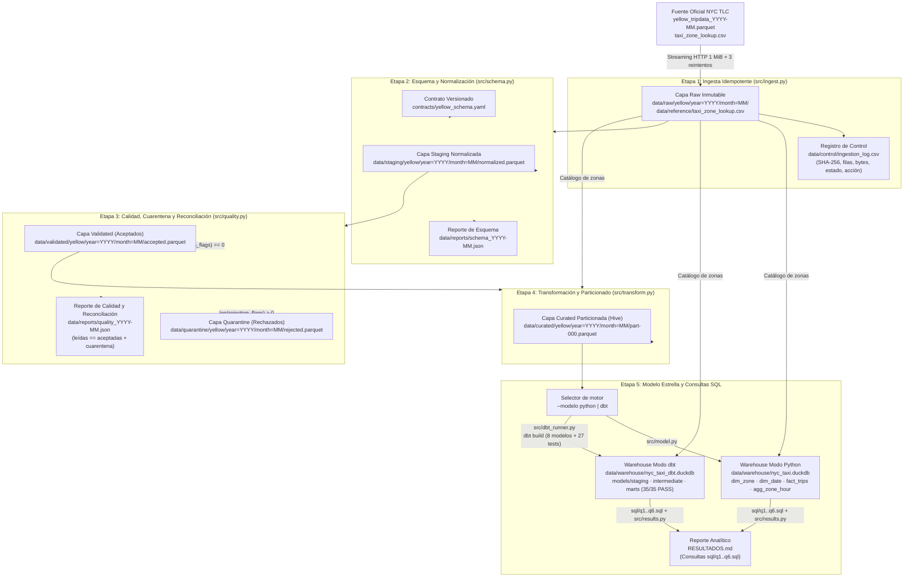
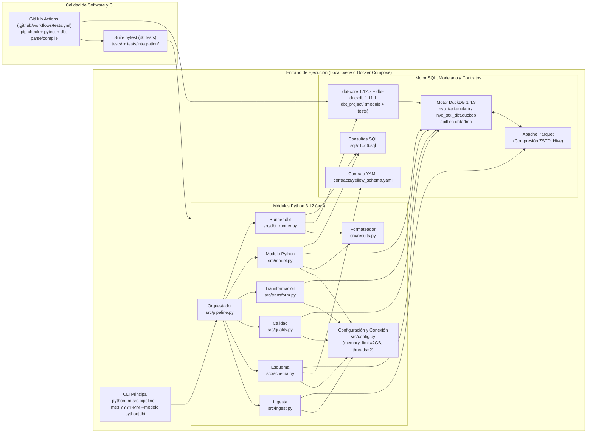
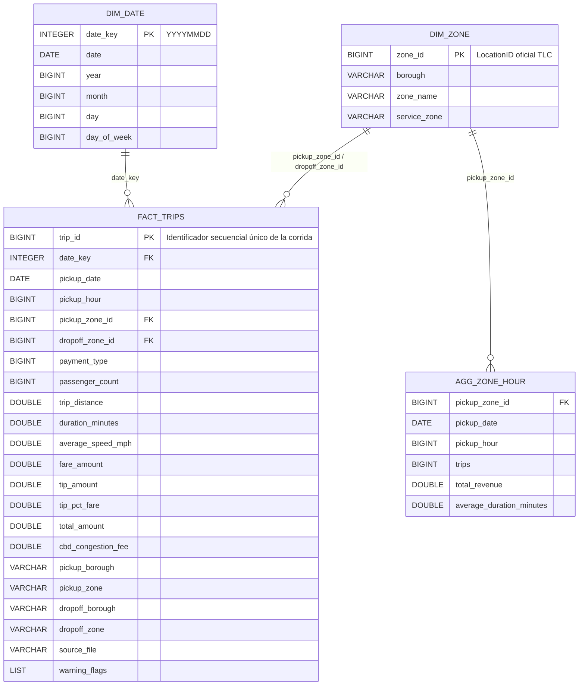
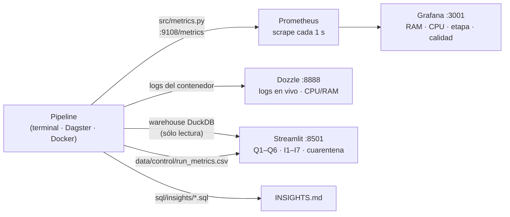

# Pipeline Batch NYC Taxi — Ingeniería de Datos (`2024-06` vs `2025-06` y Selección Dinámica de Períodos)

**Materia:** Fundamentos de Datos · Ingeniería en Sistemas de Información (4.° Año — UTN FRT)  
**Trabajo Práctico / Examen Parcial:** Pipeline Batch Reproducible NYC TLC Yellow Taxi  
**Repositorio:** `examen_Taxis`  
**Integrantes:**
- **Integrante 1:** Víctor Manuel Libran
- **Integrante 2:** Carlos Federico Lix Klett

---

## Tabla de Contenidos

1. [Problema, Objetivo y Alcance](#1-problema-objetivo-y-alcance)
2. [Fuente Oficial NYC TLC y Comparación Dinámica de Meses](#2-fuente-oficial-nyc-tlc-y-comparación-dinámica-de-meses)
3. [Arquitectura General del Pipeline](#3-arquitectura-general-del-pipeline)
4. [Diagrama del Flujo de Datos (5 Etapas)](#4-diagrama-del-flujo-de-datos-5-etapas)
5. [Diagrama de Herramientas y Componentes](#5-diagrama-de-herramientas-y-componentes)
6. [Explicación Detallada de las Cinco Etapas](#6-explicación-detallada-de-las-cinco-etapas)
7. [Justificación Tecnológica (Stack Implementado)](#7-justificación-tecnológica-stack-implementado)
8. [Reglas de Calidad (`R01`–`R08`), Cuarentena y Reconciliación Exacta](#8-reglas-de-calidad-r01r08-cuarentena-y-reconciliación-exacta)
9. [Organización de Archivos Parquet y Aislamiento de Particiones](#9-organización-de-archivos-parquet-y-aislamiento-de-particiones)
10. [Modelo Estrella y Diagrama de Entidades](#10-modelo-estrella-y-diagrama-de-entidades)
11. [Arquitectura dbt (`staging`, `intermediate` y `marts`) y Comparación con Modo Python](#11-arquitectura-dbt-staging-intermediate-y-marts-y-comparación-con-modo-python)
12. [Las Seis Consultas de Negocio, Resultados Reales y Auditoría SQL](#12-las-seis-consultas-de-negocio-resultados-reales-y-auditoría-sql)
13. [Ejecución Contenedorizada con Docker y Docker Compose](#13-ejecución-contenedorizada-con-docker-y-docker-compose)
14. [Integración Continua con GitHub Actions](#14-integración-continua-con-github-actions)
15. [Pruebas Automatizadas (`pytest` y `dbt test`)](#15-pruebas-automatizadas-pytest-y-dbt-test)
16. [Rendimiento, Análisis `EXPLAIN ANALYZE` y Presupuesto de 8 GB de RAM](#16-rendimiento-análisis-explain-analyze-y-presupuesto-de-8-gb-de-ram)
17. [Estructura Actual del Repositorio](#17-estructura-actual-del-repositorio)
18. [Guía Operativa Completa en PowerShell](#18-guía-operativa-completa-en-powershell)
19. [Limitaciones Conocidas](#19-limitaciones-conocidas)
20. [Dashboard, Monitoreo en Tiempo Real e Insights](#20-dashboard-monitoreo-en-tiempo-real-e-insights)
21. [Documentación Complementaria del Proyecto](#21-documentación-complementaria-del-proyecto)
22. [Declaración de Uso de Inteligencia Artificial (Codex, Antigravity y Claude)](#22-declaración-de-uso-de-inteligencia-artificial-codex-antigravity-y-claude)

---

## 1. Problema, Objetivo y Alcance

### Problema
El procesamiento analítico de los viajes de taxis amarillos de Nueva York (NYC TLC) plantea tres desafíos centrales de Ingeniería de Datos:
1. **Volumen de datos frente a memoria limitada:** dos meses representan entre **7,86 y 8,31 millones de filas crudas**, volumen que no debe cargarse íntegramente en estructuras en memoria de Python (como DataFrames de `pandas`) cuando se diseña para una restricción de **8 GB de RAM**.
2. **Evolución de esquema entre años (*schema drift*):** a partir de 2025 la TLC incorporó la columna `cbd_congestion_fee` (recargo por congestión del distrito central de Manhattan), ausente en los archivos de 2024.
3. **Registros crudos con anomalías operativas:** la fuente pública contiene viajes con fechas fuera del mes del archivo, bajadas anteriores o iguales a la subida, distancias nulas, cero o extremas (> 200.000 millas), importes totales negativos, cantidades de pasajeros nulas o cero y propinas negativas.

### Objetivo
Construir un **pipeline batch reproducible, idempotente y trazable** que ejecute de punta a punta con un único comando (`python -m src.pipeline --mes 2025-06`) las cinco etapas exigidas por la cátedra: ingesta con control SHA-256, validación y normalización bajo contrato YAML versionado, calidad con cuarentena y reconciliación matemática exacta, transformación hacia almacenamiento Parquet particionado estilo Hive y construcción de un modelo estrella en DuckDB para responder seis preguntas de negocio en SQL.

### Alcance
- **Selección dinámica de períodos:** recibe `--mes YYYY-MM` (por defecto `2025-06`) y procesa automáticamente ese mes junto con el mismo mes del año anterior (`YYYY-1-MM`), verificado con datos reales tanto para **junio (`2024-06` vs `2025-06`)** como para **mayo (`2024-05` vs `2025-05`)**.
- **Dos motores de modelado excluyentes e integrados:** `--modelo python` (predeterminado, en `data/warehouse/nyc_taxi.duckdb`) y `--modelo dbt` (`dbt-core` + `dbt-duckdb`, en `data/warehouse/nyc_taxi_dbt.duckdb`), que producen conteos y respuestas equivalentes para las seis consultas.
- **Doble modalidad de ejecución:** local nativa mediante entorno virtual `.venv` y contenedorizada mediante **Docker / Docker Compose**.
- **Orquestación con Dagster:** capa opcional de orquestación declarativa ([`src/orchestration.py`](src/orchestration.py)) que expone el pipeline como un DAG de nueve nodos con observabilidad por etapa y reejecución parcial desde interfaz web (`dagster dev -m src.orchestration`).
- **Capas de observación opcionales (no cambian resultados):** dashboard de resultados en **Streamlit**, monitoreo de RAM/CPU/etapas en tiempo real con **Prometheus + Grafana** y siete consultas de *insights* con su análisis (ver [sección 20](#20-dashboard-monitoreo-en-tiempo-real-e-insights)).
- **Verificación automatizada:** **40 tests en `pytest`**, **27 data tests en `dbt`** (`35/35` tareas en `dbt build`) y validación continua configurada en **GitHub Actions**.

---

## 2. Fuente Oficial NYC TLC y Comparación Dinámica de Meses

Los datos se obtienen directamente del portal público de la **New York City Taxi and Limousine Commission (NYC TLC Trip Record Data)**:
- **Archivos mensuales (Parquet):** `https://d37ci6vzurychx.cloudfront.net/trip-data/yellow_tripdata_YYYY-MM.parquet`
- **Catálogo de zonas (CSV):** `https://d37ci6vzurychx.cloudfront.net/misc/taxi_zone_lookup.csv`

### Justificación de la comparación interanual (`YYYY-MM` vs `YYYY-1-MM`)
1. **Control de estacionalidad:** comparar un mes contra el mismo mes calendario del año anterior (`2025-06` vs `2024-06`, o `2025-05` vs `2024-05`) aísla variaciones estacionales climáticas y turísticas.
2. **Evaluación real de evolución de esquema:** contrastar meses de 2024 (19 columnas, sin `cbd_congestion_fee`) con meses de 2025 (20 columnas, con `cbd_congestion_fee`) verifica en producción el contrato de esquema y permite cuantificar la proporción de viajes alcanzados por el nuevo peaje.
3. **Parametrización dinámica sin valores fijos:** [`src/pipeline.py`](src/pipeline.py), [`src/dbt_runner.py`](src/dbt_runner.py) y [`src/results.py`](src/results.py) derivan los períodos dinámicamente a partir de `--mes`. Si se solicita un período aún no publicado por la TLC (HTTP 404), [`src/ingest.py`](src/ingest.py) informa un `FileNotFoundError` explícito indicando el período faltante.

### Archivos oficiales verificados en las pruebas reales

| Archivo oficial descargado | Período | Filas crudas | Tamaño en disco | Hash SHA-256 verificado |
|---|---|---:|---:|---|
| `yellow_tripdata_2024-06.parquet` | `2024-06` | 3.539.193 | 59.859.922 B | `677cf14c8347f745b583f012fbdba072334c6c4efa17bfd6a64369f2ba30329c` |
| `yellow_tripdata_2025-06.parquet` | `2025-06` | 4.322.960 | 73.542.954 B | `1bea7f5b09c744414451fa7fef09fbc5a393ffb1621c859be6ba0df23a14e1b6` |
| `yellow_tripdata_2024-05.parquet` | `2024-05` | 3.723.833 | 62.553.128 B | `1974230be2b5a3ea92e47b5eb77f32dbf1de896d81ad8df4ab6faba52749ad23` |
| `yellow_tripdata_2025-05.parquet` | `2025-05` | 4.591.845 | 77.968.893 B | `7ef46bcd0fceee7f8c0bb38a532be05bceefabb512d4bb0b32a7727dd862b15c` |
| `taxi_zone_lookup.csv` | Catálogo | 265 | 12.331 B | `1a99e105092230f8620f301edcca7f80d3080642ff404d28ed957d3fa222c8ed` |

---

## 3. Arquitectura General del Pipeline

El sistema implementa una **arquitectura de datos multicapa sobre archivos columnares Apache Parquet y motor analítico embebido DuckDB**, con separación estricta entre almacenamiento físico por capas y motores de modelado dimensional:

1. **Capa `raw` (`data/raw/` y `data/reference/`):** inmutable. Almacena los archivos originales descargados desde NYC TLC y registra cada evento en `data/control/ingestion_log.csv`.
2. **Capa `staging` (`data/staging/`):** aplica el contrato [`contracts/yellow_schema.yaml`](contracts/yellow_schema.yaml), normaliza nombres a `snake_case`, valida conversiones sin pérdida e incorpora `cbd_congestion_fee` como `NULL::DOUBLE` en períodos anteriores a 2025.
3. **Capas `validated` y `quarantine` (`data/validated/` y `data/quarantine/`):** evalúa en una sola pasada las reglas `R01`–`R08`, separa viajes aceptados (`accepted.parquet`) de rechazados (`rejected.parquet`) y exige reconciliación exacta (`leídas == aceptadas + cuarentena`).
4. **Capa `curated` (`data/curated/`):** Parquet particionado estilo Hive (`year=YYYY/month=MM/part-000.parquet`), enriquecido con métricas derivadas y atributos geográficos de origen y destino.
5. **Capa `warehouse` (`data/warehouse/`):** construye el modelo estrella (`dim_zone`, `dim_date`, `fact_trips`, `agg_zone_hour`, `analysis_parameters`) y ejecuta las 6 consultas SQL de [`sql/`](sql/) para generar [`RESULTADOS.md`](RESULTADOS.md). Según el parámetro `--modelo`, utiliza **`nyc_taxi.duckdb`** (modo Python) o **`nyc_taxi_dbt.duckdb`** (modo dbt).

Para el análisis arquitectónico detallado de ambos modos, véase [`docs/ARQUITECTURA.md`](docs/ARQUITECTURA.md).

---

## 4. Diagrama del Flujo de Datos (5 Etapas)



---

## 5. Diagrama de Herramientas y Componentes



---

## 6. Explicación Detallada de las Cinco Etapas

### Etapa 1: Ingesta idempotente con registro de control ([`src/ingest.py`](src/ingest.py))
- **Interfaz:** `run_ingest(month: str) -> Path`.
- **Descarga atómica y reintentos:** descarga `taxi_zone_lookup.csv` (una sola vez) y `yellow_tripdata_YYYY-MM.parquet` hacia `data/raw/yellow/year=YYYY/month=MM/` leyendo en streaming fragmentos de `1 MiB` sobre un archivo temporal `.part`. Ante fallas de red (`requests.RequestException`), realiza hasta **3 reintentos con espera exponencial** (`1 s`, `2 s`, `4 s`). Antes de renombrar `.part` al destino definitivo, verifica con PyArrow que los metadatos del Parquet sean legibles o que el CSV contenga las columnas requeridas y filas válidas. Si falla, borra el `.part`, registra `status="error"` en el log y propaga la excepción (código de salida `1`).
- **Idempotencia por hash SHA-256:** calcula el SHA-256 del archivo local y lo compara con el último registro `status="ok"` en `data/control/ingestion_log.csv`. Si coincide, registra `action="reused"` y no vuelve a descargar. Si el archivo local fue alterado y el hash no coincide con el histórico, aborta sin sobrescribir la capa `raw`.

### Etapa 2: Normalización y validación de esquema ([`src/schema.py`](src/schema.py))
- **Interfaz:** `run_schema(month: str, raw_path: Path) -> Path`.
- **Contrato declarativo:** contrasta el esquema real del Parquet (`DESCRIBE`) contra [`contracts/yellow_schema.yaml`](contracts/yellow_schema.yaml) y emite `data/reports/schema_YYYY-MM.json` con el esquema observado, columnas faltantes, columnas nuevas y diferencias de tipos.
- **Política para `cbd_congestion_fee` y evolución de esquema:**
  - En períodos anteriores a 2025 (`year < 2025`), permite exclusivamente la ausencia de `cbd_congestion_fee` (`fail_except_cbd_before_2025`) y la proyecta como `CAST(NULL AS DOUBLE)`. Se utiliza `NULL` en lugar de `0.0` porque en 2024 el cargo no existía legalmente; usar `0.0` confundiría la inexistencia normativa del peaje con un viaje realizado en 2025 exento del cargo. En 2025 su presencia es obligatoria.
  - Si aparece cualquier columna nueva no declarada (`fail_and_report`) o una diferencia de tipos que implique pérdida de información (sólo se permite ampliar `TINYINT`/`SMALLINT`/`INTEGER` a `BIGINT`), registra el error en el reporte JSON y detiene la ejecución.
- **Salida:** genera `data/staging/yellow/year=YYYY/month=MM/normalized.parquet` con las 20 columnas en `snake_case` más `source_file`.

### Etapa 3: Calidad, cuarentena y reconciliación ([`src/quality.py`](src/quality.py))
- **Interfaz:** `run_quality(month: str, staged_path: Path) -> Path`.
- **Clasificación simultánea:** evalúa las 8 reglas (`R01`–`R08`) en una única consulta SQL en DuckDB y numera duplicados exactos con `row_number() OVER (PARTITION BY <columnas_del_viaje>) AS _occurrence`.
- **Separación física sin pérdida de filas:**
  - Viajes sin rechazos (`len(rejection_flags) == 0`) $\rightarrow$ `data/validated/yellow/year=YYYY/month=MM/accepted.parquet` (conserva las columnas del contrato, `source_file` y `warning_flags`).
  - Viajes con al menos un rechazo (`len(rejection_flags) > 0`) $\rightarrow$ `data/quarantine/yellow/year=YYYY/month=MM/rejected.parquet` (conserva la fila original normalizada, `source_file`, `violated_rules`, `rejection_flags` y `warning_flags`).
- **Doble reconciliación:** comprueba `rows_read == rows_accepted + rows_quarantined` tanto en la tabla clasificada como contando los dos archivos Parquet escritos en disco, y guarda `data/reports/quality_YYYY-MM.json`.

### Etapa 4: Transformación y almacenamiento Parquet particionado ([`src/transform.py`](src/transform.py))
- **Interfaz:** `run_transform(month: str, validated_path: Path) -> Path`.
- **Enriquecimiento y métricas derivadas:** sobre `accepted.parquet`, calcula `duration_minutes`, `average_speed_mph`, `pickup_date`, `pickup_hour`, `pickup_day_of_week` y `tip_pct_fare` (definido cuando `fare_amount > 0`), y une por `LEFT JOIN` el catálogo de zonas para incorporar `pickup_borough`, `pickup_zone`, `pickup_service_zone`, `dropoff_borough`, `dropoff_zone` y `dropoff_service_zone`.
- **Escritura particionada estilo Hive:** publica atómicamente `data/curated/yellow/year=YYYY/month=MM/part-000.parquet` con compresión `ZSTD`.

### Etapa 5: Modelo estrella, agregados y seis consultas SQL ([`src/model.py`](src/model.py), [`src/dbt_runner.py`](src/dbt_runner.py) y [`sql/`](sql/))
- **Interfaz:** `run_model(months: list[str]) -> None`.
- **Ejecución por motor seleccionado:** construye `dim_zone`, `dim_date`, `fact_trips`, `agg_zone_hour` y `analysis_parameters` en el warehouse del motor elegido (`python` o `dbt`), ejecuta las 6 consultas SQL de [`sql/`](sql/) y genera [`RESULTADOS.md`](RESULTADOS.md) mediante [`src/results.py`](src/results.py).

---

## 7. Justificación Tecnológica (Stack Implementado)

Todas las dependencias se encuentran fijadas en [`requirements.txt`](requirements.txt):

| Tecnología | Versión fijada | Rol y justificación en la arquitectura |
|---|---|---|
| **Python** | `3.10+` (`3.12.16`) | Orquestación modular, descargas HTTP en streaming, control SHA-256, invocación de dbt y formateo de reportes. |
| **DuckDB** | `1.4.3` | Motor SQL analítico columnar *in-process*. Consulta y escribe Parquet directamente en C++ sin pasar filas por Python, con techo estricto de memoria (`memory_limit='2GB'`) y derrame a disco (`data/tmp`). |
| **Apache Parquet + PyArrow** | `22.0.0` | Almacenamiento columnar comprimido (`ZSTD`) particionado por `year` y `month`. PyArrow valida metadatos (`num_rows`) en la descarga y genera fixtures sintéticos en los tests. |
| **dbt-core + dbt-duckdb** | `1.12.7` / `1.11.1` | Modelado dimensional declarativo (`staging`, `intermediate`, `marts`) con linaje explícito (`source()`, `ref()`) y 27 pruebas de integridad (`dbt build` / `dbt test`). |
| **PyYAML** | `6.0.3` | Lectura del contrato de esquema versionado [`contracts/yellow_schema.yaml`](contracts/yellow_schema.yaml). |
| **Requests** | `2.32.5` | Descarga HTTP en streaming de bloques de 1 MiB con *timeouts* `(15, 120)` s y reintentos exponenciales. |
| **pytest** | `9.0.2` | Suite de 40 pruebas unitarias, de integración y de orquestación sobre datos sintéticos sin dependencia de Internet. |
| **Docker + Docker Compose** | Engine `29.x` / Compose `v5` | Empaquetado reproducible del entorno Linux (`python:3.12-slim` + `git` + `requirements.txt`) con volumen persistente `./data:/app/data` y límite `mem_limit: 4g`. |
| **GitHub Actions** | `ubuntu-latest` (Python `3.12`) | Integración continua liviana (`.github/workflows/tests.yml`): `pip check`, `pytest -q`, `dbt parse` y `dbt compile`. |
| **Dagster** | `1.13.31` | Orquestador declarativo de pipelines. Define un DAG de nueve nodos (dos cadenas de cuatro etapas convergiendo en el modelo estrella), registra metadatos por etapa (filas leídas, aceptadas, en cuarentena) y ofrece interfaz web (`dagster dev`) para observar, lanzar y relanzar ejecuciones. Documentado en [`docs/DAGSTER.md`](docs/DAGSTER.md). |
| **Streamlit** | `1.67.0` | Dashboard de resultados en Python ([`dashboard/app.py`](dashboard/app.py)): reutiliza las consultas de `sql/`, abre el warehouse en sólo lectura y permite explorar la cuarentena. Dependencia separada en `requirements-dashboard.txt`. |
| **Prometheus + Grafana** | `v3.5.0` / `12.1.0` | Monitoreo en tiempo real ([`monitoring/`](monitoring/)): Prometheus recolecta cada segundo las métricas que publica el pipeline y Grafana las grafica contra los límites de 2/4/8 GB. Tablero provisionado como código. |
| **Dozzle** | `v8.12.0` | Visor web de los logs de los contenedores en vivo, con CPU y RAM de cada uno (`http://localhost:8888`). Acceso de sólo lectura al socket de Docker y filtrado a los contenedores `nyc_taxi_*`. |
| **psutil + prometheus-client** | `7.2.2` / `0.26.0` | Medición de RAM y CPU del propio proceso (incluye DuckDB) y exportación en formato Prometheus desde [`src/metrics.py`](src/metrics.py). |

La comparación detallada de cada herramienta contra sus alternativas (pandas, Polars, PySpark, Airflow, Prefect, Power BI, cAdvisor, etc.) está en [`docs/TECNOLOGIAS.md`](docs/TECNOLOGIAS.md).

---

## 8. Reglas de Calidad (`R01`–`R08`), Cuarentena y Reconciliación Exacta

### Catálogo de las 8 reglas implementadas en [`src/quality.py`](src/quality.py)

| ID | Descripción | Condición de violación | Severidad | Justificación de umbral y severidad | Violaciones `2024-06` | Violaciones `2025-06` | Violaciones `2024-05` | Violaciones `2025-05` |
|---|---|---|---|---|---:|---:|---:|---:|
| **R01** | Subida nula o fuera del mes | `pickup IS NULL` o fuera de `[inicio_mes, próximo_mes)` | **Rechazo** (`reject`) | La fecha de subida define el período analítico; registros de otros meses distorsionan la serie mensual. | 51 | 20 | 33 | 24 |
| **R02** | Bajada nula o no posterior a subida | `dropoff IS NULL` o `pickup IS NULL` o `dropoff <= pickup` | **Rechazo** (`reject`) | Todo viaje válido debe tener duración estrictamente positiva (`duration_minutes > 0`). | 1.140 | 68.583 | 1.147 | 64.272 |
| **R03** | Distancia inválida o extrema | `trip_distance IS NULL`, no finita, `<= 0` o `> 200` mi | **Rechazo** (`reject`) | Distancia `<= 0` impide calcular velocidades reales; el umbral operativo de 200 millas acota errores graves de taxímetro (máximos > 195.000 mi). | 53.084 | 135.118 | 49.909 | 141.430 |
| **R04** | Importe total negativo o nulo | `total_amount IS NULL`, no finito o `< 0` | **Rechazo** (`reject`) | Importes negativos corresponden a reversos o contracargos contables. Se admite `total_amount == 0`. | 48.795 | 74.257 | 48.992 | 112.544 |
| **R05** | Pasajeros nulos o `<= 0` | `passenger_count IS NULL` o `<= 0` | **Advertencia** (`warning`) | Representa > 1,2 M de viajes por mes en 2025 (viajes despachados por app / *Flex Fare*). Rechazarlos descartaría ~28–30 % del volumen válido en tiempo, zona e importe. | 446.620 | 1.235.737 | 444.414 | 1.220.143 |
| **R06** | Zona de origen o destino inexistente | `pu_location_id` o `do_location_id` ausente en `taxi_zone_lookup.csv` | **Rechazo** (`reject`) | Garantiza integridad referencial con `dim_zone`. Los IDs `264` y `265` están presentes en el catálogo oficial TLC. | 0 | 0 | 0 | 0 |
| **R07** | Duplicado exacto de fila | `_occurrence > 1` sobre todas las columnas del viaje | **Rechazo** (`reject`) | Conserva una copia en `accepted.parquet` y envía las repeticiones exactas a cuarentena. | 0 | 0 | 0 | 0 |
| **R08** | Propina negativa *(regla propia)* | `tip_amount < 0` | **Advertencia** (`warning`) | Hallada en la exploración de datos reales. Si el total es negativo, la fila se rechaza por `R04`; si el total es `>= 0`, se conserva señalada en `warning_flags`. | 108 | 367 | 114 | 195 |

### Reconciliación matemática verificada en Junio y Mayo

Una fila con múltiples rechazos se escribe **una sola vez** en `rejected.parquet` con todas las reglas violadas en `violated_rules` y `rejection_flags`. La reconciliación exige `rows_read == rows_accepted + rows_quarantined`:

| Período procesado | Filas Originales Leídas (`raw`) | Filas Aceptadas (`validated` / `curated`) | Filas en Cuarentena (`quarantine`) | % Aceptado | % Cuarentena | Verificación `leídas == aceptadas + cuarentena` |
|---|---:|---:|---:|---:|---:|---|
| **`2024-06`** | 3.539.193 | 3.441.465 | 97.728 | 97,24 % | 2,76 % | `3.539.193 = 3.441.465 + 97.728` (`reconciled: true`) |
| **`2025-06`** | 4.322.960 | 4.052.233 | 270.727 | 93,74 % | 6,26 % | `4.322.960 = 4.052.233 + 270.727` (`reconciled: true`) |
| **Total Junio (`2024-06` + `2025-06`)** | **7.862.153** | **7.493.698** | **368.455** | **95,31 %** | **4,69 %** | **Exacta (`7.493.698` en `fact_trips`)** |
| **`2024-05`** | 3.723.833 | 3.629.197 | 94.636 | 97,46 % | 2,54 % | `3.723.833 = 3.629.197 + 94.636` (`reconciled: true`) |
| **`2025-05`** | 4.591.845 | 4.285.343 | 306.502 | 93,33 % | 6,67 % | `4.591.845 = 4.285.343 + 306.502` (`reconciled: true`) |
| **Total Mayo (`2024-05` + `2025-05`)** | **8.315.678** | **7.914.540** | **401.138** | **95,18 %** | **4,82 %** | **Exacta (`7.914.540` en `fact_trips`)** |

---

## 9. Organización de Archivos Parquet y Aislamiento de Particiones

Todas las capas Parquet siguen particionado estilo Hive (`year=YYYY/month=MM/`) bajo `data/` (o `NYC_TAXI_DATA_DIR`):

- **Lectura segura con `hive_partitioning=false`:** al leer un archivo mensual puntual (`read_parquet('.../part-000.parquet', hive_partitioning=false)`), se evita que DuckDB inyecte columnas virtuales `year` y `month` que alterarían la validación del contrato o la partición de duplicados exactos (`R07`).
- **Escritura atómica y reemplazo por partición:** `copy_parquet` en [`src/config.py`](src/config.py) exporta con `FORMAT PARQUET, COMPRESSION ZSTD` hacia un archivo `.parquet.tmp` y luego ejecuta `tmp.replace(path)`.
- **Aislamiento demostrado:** reprocesar un mes reemplaza exclusivamente el archivo `part-000.parquet` de ese período y mantiene intactos los bytes y timestamps (`st_mtime_ns`) de los demás meses, propiedad verificada automáticamente por `tests/integration/test_integration_pipeline.py::test_partition_isolation_on_reprocess`.

| Partición / Tabla (Corrida Junio) | Filas Leídas | Aceptadas / Curadas (Ejecución 1) | Aceptadas / Curadas (Ejecución 2) | Cuarentena (Ejecución 1 y 2) |
|---|---:|---:|---:|---:|
| `year=2024/month=06` | 3.539.193 | 3.441.465 | 3.441.465 | 97.728 |
| `year=2025/month=06` | 4.322.960 | 4.052.233 | 4.052.233 | 270.727 |
| `fact_trips` (total) | 7.862.153 | 7.493.698 | 7.493.698 | 368.455 |

---

## 10. Modelo Estrella y Diagrama de Entidades

Ambos motores (`python` y `dbt`) materializan el mismo modelo dimensional en su respectivo warehouse DuckDB:



### Granularidad y conteos verificados (Junio y Mayo)

| Tabla | Rol dimensional | Granularidad exacta | Filas Junio (`2024-06` + `2025-06`) | Filas Mayo (`2024-05` + `2025-05`) | Regla de integridad verificada |
|---|---|---|---:|---:|---|
| **`fact_trips`** | Tabla de hechos | 1 fila por viaje aceptado en los dos meses comparados | **7.493.698** | **7.914.540** | `COUNT(*) == COUNT(DISTINCT trip_id)` (`0` duplicados, `0` huérfanos) |
| **`dim_zone`** | Dimensión geográfica | 1 fila por zona del catálogo oficial TLC (`zone_id`) | **265** | **265** | Incluye las 263 zonas geográficas más `264` (`Unknown`) y `265` (`Outside of NYC`) |
| **`dim_date`** | Dimensión temporal | 1 fila por fecha calendario de subida (`pickup_date`) | **60** | **62** | 30+30 días en junio; 31+31 días en mayo (`date_key` `YYYYMMDD`) |
| **`agg_zone_hour`** | Tabla agregada | 1 fila por grupo horario `(pickup_zone_id, pickup_date, pickup_hour)` | **210.698** | **216.223** | **Junio:** `210.698` grupos horarios con `SUM(trips) = 7.493.698`<br>**Mayo:** `216.223` grupos horarios con `SUM(trips) = 7.914.540` |
| **`analysis_parameters`** | Metadatos de corrida | 1 fila con `(comparison_month, target_month)` | **1** | **1** | Parametriza dinámicamente las 6 consultas SQL de `sql/` |

> **Nota sobre `agg_zone_hour`:** `COUNT(*)` sobre `agg_zone_hour` devuelve la cantidad de combinaciones únicas `(zona, fecha, hora)` con viajes (`210.698` en junio), mientras que `SUM(trips)` sobre esa misma tabla reconstituye el total exacto de viajes aceptados (`7.493.698` en junio).

---

## 11. Arquitectura dbt (`staging`, `intermediate` y `marts`) y Comparación con Modo Python

El proyecto [`dbt_project/`](dbt_project/) organiza la construcción declarativa del warehouse `data/warehouse/nyc_taxi_dbt.duckdb` en tres capas:

1. **Fuentes externas ([`dbt_project/models/sources.yml`](dbt_project/models/sources.yml)):** declara la fuente `taxi_external` apuntando mediante `external_location` a los Parquet reales (`accepted_comparison`, `accepted_target`, `curated_comparison`, `curated_target`) y a `taxi_zone_lookup.csv`, parametrizados con variables Jinja (`comparison_year`, `comparison_month_num`, `target_year`, `target_month_num`).
2. **Capa `staging` (`+materialized: view`):**
   - [`stg_taxi_zones.sql`](dbt_project/models/staging/stg_taxi_zones.sql): tipa las columnas del catálogo de zonas desde `{{ source('taxi_external', 'taxi_zone_lookup') }}`.
   - [`stg_yellow_trips.sql`](dbt_project/models/staging/stg_yellow_trips.sql): unifica con `UNION ALL` las particiones curadas del mes de comparación y del mes asignado usando `source()`.
3. **Capa `intermediate` (`+materialized: view`):**
   - [`int_trips_enriched.sql`](dbt_project/models/intermediate/int_trips_enriched.sql): referencia `{{ ref('stg_yellow_trips') }}` como vista intermedia sin duplicar en disco la transformación pesada ya ejecutada por `src.transform`.
4. **Capa `marts` (`+materialized: table`):**
   - [`dim_zone.sql`](dbt_project/models/marts/dim_zone.sql), [`dim_date.sql`](dbt_project/models/marts/dim_date.sql), [`fact_trips.sql`](dbt_project/models/marts/fact_trips.sql), [`agg_zone_hour.sql`](dbt_project/models/marts/agg_zone_hour.sql) y [`analysis_parameters.sql`](dbt_project/models/marts/analysis_parameters.sql), encadenados mediante `{{ ref(...) }}`.

### Diferencias operativas entre `--modelo python` y `--modelo dbt`

| Aspecto | Modo Python (`--modelo python`, por defecto) | Modo dbt (`--modelo dbt`) |
|---|---|---|
| **Etapas 1 a 4 (`ingest`, `schema`, `quality`, `transform`)** | Ejecutadas por Python + DuckDB | Exactamente las mismas (no se duplican) |
| **Constructor de la Etapa 5** | [`src/model.py`](src/model.py) (`CREATE OR REPLACE TABLE`) | [`src/dbt_runner.py`](src/dbt_runner.py) (`dbt build` con `--vars` dinámicas) |
| **Archivo Warehouse DuckDB** | `data/warehouse/nyc_taxi.duckdb` (`527,51 MiB`) | `data/warehouse/nyc_taxi_dbt.duckdb` (`546,01 MiB`) |
| **Hilos en DuckDB (`threads`)** | `2` | `1` (evita colisión de `temp_directory` entre cursores en `dbt-duckdb`) |
| **Validación del modelo estrella** | Suite `pytest` + tests de integración SQL | **27 data tests en `dbt`** (`not_null`, `unique`, `relationships` y 4 tests SQL singulares) + `pytest` |
| **Consultas de negocio (`sql/q1..q6.sql`)** | Ejecutadas sobre `nyc_taxi.duckdb` | Ejecutadas sobre `nyc_taxi_dbt.duckdb` (resultados **equivalentes dentro de `1e-5`**) |

---

## 12. Las Seis Consultas de Negocio, Resultados Reales y Auditoría SQL

Las seis consultas de [`sql/`](sql/) se ejecutan sobre el warehouse activo y sus salidas completas se vuelcan en [`RESULTADOS.md`](RESULTADOS.md). Todas fueron auditadas técnicamente y con `EXPLAIN ANALYZE` (véanse [`docs/AUDITORIA_TECNICA.md`](docs/AUDITORIA_TECNICA.md) y [`docs/RENDIMIENTO.md`](docs/RENDIMIENTO.md)).

### Q1 — Top 10 zonas de origen con más viajes ([`sql/q1_top_zones.sql`](sql/q1_top_zones.sql))

- **Corrección de auditoría SQL aplicada:** el catálogo oficial de TLC contiene nombres de zona repetidos para distintos `LocationID` (por ejemplo, `Corona` tiene IDs `56` y `57`, y `Governor's Island/Ellis Island/Liberty Island` tiene IDs `103`, `104` y `105`). Para evitar fusionar zonas homónimas, `q1_top_zones.sql` agrupa y une explícitamente por clave y nombre (`GROUP BY pickup_zone_id, pickup_zone` y `LEFT JOIN ... USING (pickup_zone_id, pickup_zone)`).

| Posición | Zona de origen (`pickup_zone`) | Viajes `2025-06` | Viajes `2024-06` | Variación interanual (%) |
|---:|---|---:|---:|---:|
| 1 | `JFK Airport` | 170.662 | 152.171 | +12,15 % |
| 2 | `Upper East Side South` | 169.820 | 156.503 | +8,51 % |
| 3 | `Midtown Center` | 168.115 | 159.330 | +5,51 % |
| 4 | `Upper East Side North` | 147.498 | 140.822 | +4,74 % |
| 5 | `Midtown East` | 122.391 | 118.073 | +3,66 % |
| 6 | `Penn Station/Madison Sq West` | 121.996 | 108.741 | +12,19 % |
| 7 | `Times Sq/Theatre District` | 121.497 | 113.406 | +7,13 % |
| 8 | `Lincoln Square East` | 109.013 | 105.089 | +3,73 % |
| 9 | `LaGuardia Airport` | 108.971 | 112.984 | -3,55 % |
| 10 | `Murray Hill` | 108.388 | 101.329 | +6,97 % |

### Q2 — Hora del día con mayor ingreso promedio por viaje ([`sql/q2_peak_revenue_hour.sql`](sql/q2_peak_revenue_hour.sql))
- **Resultado (`2025-06`):** **`05:00` h** (`pickup_hour = 5`), con **`33.314` viajes**, ingreso total de **`$1.085.064,60`** e ingreso promedio de **`$32,5708` por viaje**.
- **Alcance analítico:** la consulta identifica la hora que maximiza el ingreso medio unitario (`AVG(total_amount)`), no la hora de mayor facturación acumulada total. Como sólo agrupa por `pickup_hour`, no atribuye causalidad por sí sola.

### Q3 — Porcentaje de viajes con `cbd_congestion_fee > 0` ([`sql/q3_cbd_fee.sql`](sql/q3_cbd_fee.sql))
- **Resultado global (`2025-06`):** **`2.987.770` de `4.052.233` viajes aceptados** (**`73,7314 %`**) registran `cbd_congestion_fee > 0`.
- **Top 5 zonas de origen por proporción y lectura con denominador:**

| Zona de origen (`pickup_zone`) | Viajes con cargo (`trips_with_fee`) | Viajes totales en la zona (`trips_in_zone`) | Proporción (`pct_zone_with_cbd_fee`) | Observación de auditoría |
|---|---:|---:|---:|---|
| `Rikers Island` | 1 | 1 | **100,0000 %** | Denominador mínimo (`1/1`); porcentaje matemáticamente exacto pero sin volumen representativo. |
| `Greenwich Village South` | 56.670 | 56.778 | **99,8098 %** | Zona dentro del CBD de Manhattan con alto volumen. |
| `West Village` | 87.904 | 88.077 | **99,8036 %** | Zona dentro del CBD de Manhattan con alto volumen. |
| `SoHo` | 33.833 | 33.907 | **99,7818 %** | Zona dentro del CBD de Manhattan con alto volumen. |
| `Greenwich Village North` | 54.600 | 54.720 | **99,7807 %** | Zona dentro del CBD de Manhattan con alto volumen. |

### Q4 — Propina promedio (% de la tarifa) por tipo de pago ([`sql/q4_tip_by_payment.sql`](sql/q4_tip_by_payment.sql))

| `payment_type` | Categoría oficial TLC | Viajes `2025-06` | Propina promedio (`%` de tarifa) | Interpretación técnica |
|---:|---|---:|---:|---|
| `0` | Flex Fare trip | 1.118.536 | 1,4894 % | Viajes de tarifa preacordada/app; no representa un medio de pago tradicional con propina por taxímetro. |
| `1` | Credit card (Tarjeta) | 2.518.105 | **25,2574 %** | Medio electrónico donde la propina queda registrada sistemáticamente. |
| `2` | Cash (Efectivo) | 352.359 | 0,0020 % | **No interpretable como propina real:** las propinas en efectivo entregadas al conductor no se registran en `tip_amount`. |
| `3` | No charge (Sin cargo) | 14.333 | 0,0738 % | Viajes sin cobro al pasajero. |
| `4` | Dispute (En disputa) | 48.899 | 0,0334 % | Transacciones disputadas. |
| `5` | Unknown (Desconocido) | 1 | 0,0000 % | Registro residual único. |

### Q5 — Viajes con origen o destino en aeropuertos JFK o LaGuardia ([`sql/q5_airports.sql`](sql/q5_airports.sql))

| Período | Viajes (`JFK Airport` o `LaGuardia Airport`) | Tarifa media (`AVG(fare_amount)`) |
|---|---:|---:|
| **`2024-06`** | 334.938 | `$56,2601` |
| **`2025-06`** | 346.769 | `$57,7605` |

- **Nota de auditoría QA:** en `taxi_zone_lookup.csv` el nombre oficial de la zona 138 es `"LaGuardia Airport"` (sin espacio). La consulta utiliza `LIKE '%laguardia%'` y está cubierta por el test de regresión `tests/integration/test_sql_business_rules.py::test_q5_airports_includes_both_jfk_and_laguardia`.

### Q6 — Variación interanual de viajes y tarifa media ([`sql/q6_month_variation.sql`](sql/q6_month_variation.sql))

| Mes comparación | Mes asignado | Viajes aceptados `2024-06` | Viajes aceptados `2025-06` | Variación absoluta | Variación `%` | Tarifa media `2024-06` | Tarifa media `2025-06` | Variación tarifa media |
|---|---|---:|---:|---:|---:|---:|---:|---:|
| `2024-06` | `2025-06` | 3.441.465 | 4.052.233 | +610.768 | **+17,75 %** | `$19,8668` | `$19,7080` | **`-$0,1588`** |

- **Alcance e interpretación (≤ 5 líneas):** la consulta compara los **viajes aceptados** (post-calidad) entre ambos períodos. El aumento del `+17,75 %` en volumen junto con la leve variación de `-$0,16` en tarifa base es descriptivamente compatible con la mayor proporción de viajes *Flex Fare* (`payment_type = 0`) y trayectos urbanos intermedios en 2025, pero un corte de dos meses no demuestra causalidad atribuible al peaje CBD sin controlar estacionalidad plurianual, oferta y otros modos de transporte.

---

## 13. Ejecución Contenedorizada con Docker y Docker Compose

El proyecto incluye una solución Docker batch minimalista ([`Dockerfile`](Dockerfile), [`docker-compose.yml`](docker-compose.yml), [`.dockerignore`](.dockerignore) y guía detallada en [`docs/DOCKER.md`](docs/DOCKER.md)):

- **Diseño sin servicios superfluos:** un único servicio batch (`pipeline`, imagen `examen-nyc-taxi:latest` basada en `python:3.12-slim` + `git` + `requirements.txt`) que ejecuta la tarea solicitada y finaliza (`restart: "no"`), sin dejar demonios residentes consumiendo memoria.
- **Imagen sin datos y persistencia por volúmenes:** `.dockerignore` excluye `data/` y `.venv/` (el contexto de build pesa ~`275 KB`). `docker-compose.yml` monta `./data:/app/data` y `./RESULTADOS.md:/app/RESULTADOS.md`, reutilizando los Parquet `raw` locales por hash SHA-256 y preservando ambos warehouses en el host.
- **Carácter opcional:** Docker es una alternativa de reproducción aislada; **no es una dependencia obligatoria** para ejecutar el pipeline localmente con `.venv`.

---

## 14. Integración Continua con GitHub Actions

El repositorio cuenta con el workflow [`.github/workflows/tests.yml`](.github/workflows/tests.yml) (documentado en [`docs/CI.md`](docs/CI.md)):

- **Disparadores:** se activa en `push` y `pull_request` sobre `ubuntu-latest` con **Python 3.12**.
- **Pasos que ejecuta:**
  1. Instala exactamente las dependencias de [`requirements.txt`](requirements.txt).
  2. Verifica la consistencia de paquetes con `python -m pip check`.
  3. Ejecuta la suite completa de 40 pruebas sintéticas con `python -m pytest -q`.
  4. Valida estáticamente el proyecto dbt con `dbt parse` y `dbt compile` usando directorios temporales del runner y variables explícitas de período.
- **Qué no ejecuta deliberadamente:** no descarga los cientos de megabytes de Parquet desde NYC TLC ni corre `dbt build` sobre datos reales en los runners de GitHub, evitando tiempos elevados y tráfico innecesario en cada commit.
- **Estado de verificación:** todos los comandos del workflow fueron ejecutados y validados localmente; la primera ejecución remota en la pestaña *Actions* de GitHub tendrá lugar una vez que se publique (`git push`) la rama al repositorio remoto.

---

## 15. Pruebas Automatizadas (`pytest` y `dbt test`)

La calidad del software y de los datos se verifica en dos niveles complementarios:

1. **Suite Python (`pytest -q` $\rightarrow$ `40 passed`):**
   - [`tests/test_ingest.py`](tests/test_ingest.py): idempotencia de descargas, detección de corrupción por SHA-256 y limpieza de `.part` tras 3 reintentos fallidos de red.
   - [`tests/test_schema.py`](tests/test_schema.py): mapeo a `snake_case`, inyección de `cbd_congestion_fee = NULL::DOUBLE` en 2024, obligatoriedad en 2025 y rechazo de *schema drift*.
   - [`tests/test_quality.py`](tests/test_quality.py) y [`tests/test_reconciliation.py`](tests/test_reconciliation.py): las 8 reglas `R01`–`R08`, múltiples violaciones en una misma fila y falla ante desbalance de conteos.
   - [`tests/test_pipeline.py`](tests/test_pipeline.py): contrato del orquestador, delegación excluyente a `src.model` o `src.dbt_runner` y propagación de errores.
   - [`tests/test_dynamic_months.py`](tests/test_dynamic_months.py): validación de meses dinámicos (`2025-01` a `2025-12`), variables Jinja de dbt, manejo de HTTP 404 para meses futuros e interpretaciones parametrizadas en [`src/results.py`](src/results.py).
   - [`tests/integration/test_integration_pipeline.py`](tests/integration/test_integration_pipeline.py) y [`tests/integration/test_sql_business_rules.py`](tests/integration/test_sql_business_rules.py): corrida extremo a extremo de las 5 etapas con datos sintéticos, idempotencia en doble corrida, aislamiento físico de particiones Hive y regresión SQL para `LaGuardia Airport`.
   - [`tests/test_orchestration.py`](tests/test_orchestration.py): estructura del grafo Dagster (9 nodos y dependencias), resolución de períodos, validación de configuración, corrida completa e idempotencia, compatibilidad con `src.pipeline` y propagación de errores.
2. **Suite declarativa dbt (`dbt build` $\rightarrow$ `35/35 PASS`; `dbt test` $\rightarrow$ `27/27 PASS`):**
   - 23 tests genéricos en [`dbt_project/models/schema.yml`](dbt_project/models/schema.yml) (`not_null`, `unique` y `relationships` entre `fact_trips`, `dim_zone` y `dim_date`).
   - 4 tests singulares SQL en [`dbt_project/tests/`](dbt_project/tests/): [`agg_zone_hour_reconciles.sql`](dbt_project/tests/agg_zone_hour_reconciles.sql), [`fact_trip_count_matches_sources.sql`](dbt_project/tests/fact_trip_count_matches_sources.sql) y [`fact_zone_referential_integrity.sql`](dbt_project/tests/fact_zone_referential_integrity.sql).

---

## 16. Rendimiento, Análisis `EXPLAIN ANALYZE` y Presupuesto de 8 GB de RAM

### Diseño para la restricción de 8 GB de RAM
1. **Cero carga de datasets en memoria de Python:** ni `pandas` ni listas de registros se utilizan para procesar viajes; DuckDB opera directamente sobre flujos Parquet.
2. **Límites explícitos en DuckDB:** `memory_limit='2GB'`, `threads='2'` en modo Python (`threads: 1` en `dbt_project/profiles.yml`), `preserve_insertion_order=false` y derrame a disco en `data/tmp` (que queda vacío al finalizar).
3. **Generación de `trip_id` en streaming:** el uso de vistas sobre `curated` y `row_number() OVER ()` evita ordenar globalmente 7,5 millones de filas con listas anidadas (`warning_flags`).

### Límites configurados vs. consumos reales observados (`2024-06` + `2025-06`)

| Entorno y Modo | Límite Configurado | Tiempo Total Observado | Pico de RAM Observado | Tamaño del Warehouse |
|---|---|---:|---:|---:|
| **Local `.venv` — Modo Python** | DuckDB `2 GB` (`threads=2`) | **`31,1 s` – `31,36 s`** | **`~2.023 MB`** (Working Set árbol de procesos) | `527,51 MiB` |
| **Local `.venv` — Modo dbt** | DuckDB `2 GB` (`threads=1`) | **`37,9 s` – `39,00 s`** | **`~2.001 MB`** (Working Set árbol de procesos) | `546,01 MiB` |
| **Docker Compose — Modo Python** | Contenedor `4 GiB` / DuckDB `2 GB` | **`45,16 s`** | **`1,851 GiB`** (`docker stats` del contenedor) | `527,51 MiB` |
| **Docker Compose — Modo dbt** | Contenedor `4 GiB` / DuckDB `2 GB` | **`48,30 s` – `53,15 s`** | **`1,872 GiB`** (`docker stats` del contenedor) | `532,26` – `546,01 MiB` |

> **Aclaración metodológica sobre el hardware de prueba:** Las mediciones anteriores se realizaron en una máquina de desarrollo con 16 GB de RAM física. Demuestran que el proceso del pipeline y el contenedor respetan estrictamente el presupuesto de ~`1,85–2,02 GB` (muy por debajo del tope de 8 GB), aunque la validación física en una notebook con exactamente 8 GB instalados queda pendiente; en un equipo de 8 GB que utilice Docker Desktop en Windows debe considerarse además la memoria base consumida por el sistema operativo y la máquina virtual de WSL 2 (`vmmemWSL`), siendo recomendable la ejecución local con `.venv` cuando se desee minimizar el overhead de virtualización.

### Auditoría de planes de ejecución (`EXPLAIN ANALYZE`)
En [`docs/RENDIMIENTO.md`](docs/RENDIMIENTO.md) se auditaron los planes físicos en DuckDB:
- **Q1 (`q1_top_zones.sql`):** plan compuesto por `TABLE_SCAN`, dos `HASH_GROUP_BY`, `HASH_JOIN` y `TOP_N`. Al agrupar por `(pickup_zone_id, pickup_zone)` en lugar de sólo `pickup_zone`, la mediana de 3 ejecuciones pasó de `121,39 ms` (`0,120 s` en `EXPLAIN ANALYZE`) a **`138,92 ms`** (**`0,139 s`** en `EXPLAIN ANALYZE`, `+14,4 %`), costo mínimo y aceptable para preservar la identidad correcta de zonas con nombres repetidos.
- **Q6 (`q6_month_variation.sql`):** plan compuesto por `TABLE_SCAN`, `HASH_GROUP_BY`, `CTE_SCAN` y `HASH_JOIN`, con una mediana de **`54,86 ms`** (**`0,056 s`** en `EXPLAIN ANALYZE`).

---

## 17. Estructura Actual del Repositorio

```text
examen_Taxis/
├── .github/
│   └── workflows/
│       └── tests.yml                              # CI en GitHub Actions (pip check, pytest, dbt parse/compile)
├── contracts/
│   └── yellow_schema.yaml                         # Contrato declarativo de esquema v1 (20 columnas y políticas)
├── dbt_project/
│   ├── dbt_project.yml                            # Configuración del proyecto dbt y variables por defecto
│   ├── profiles.yml                               # Perfil DuckDB (memory_limit=2GB, threads=1, spill en data/tmp)
│   ├── models/
│   │   ├── sources.yml                            # Fuentes externas Parquet (accepted, curated) y CSV de zonas
│   │   ├── schema.yml                             # 23 tests declarativos + descripciones para dbt docs
│   │   ├── staging/
│   │   │   ├── stg_taxi_zones.sql                 # Vista tipada del catálogo de zonas TLC
│   │   │   └── stg_yellow_trips.sql               # Vista unificada de los dos períodos comparados
│   │   ├── intermediate/
│   │   │   └── int_trips_enriched.sql             # Vista intermedia sobre la capa curada
│   │   └── marts/
│   │       ├── analysis_parameters.sql            # Tabla de parámetros del período activo
│   │       ├── dim_zone.sql                       # Tabla dimensión de zonas (265 filas)
│   │       ├── dim_date.sql                       # Tabla dimensión de fechas (60 en junio / 62 en mayo)
│   │       ├── fact_trips.sql                     # Tabla de hechos de viajes aceptados
│   │       └── agg_zone_hour.sql                  # Tabla agregada por zona de origen, fecha y hora
│   └── tests/
│       ├── agg_zone_hour_reconciles.sql           # Test singular: SUM(agg_zone_hour.trips) == COUNT(fact_trips)
│       ├── fact_trip_count_matches_sources.sql    # Test singular: fact_trips coincide con suma de fuentes aceptadas
│       ├── fact_zone_referential_integrity.sql    # Test singular: 0 huérfanos entre fact_trips y dim_zone
│       └── fact_respects_quality_gate.sql         # Test singular: ningún viaje del hecho viola una regla de rechazo
├── dashboard/
│   └── app.py                                     # Dashboard Streamlit: Q1–Q6, insights, calidad, cuarentena y rendimiento
├── docs/
│   ├── ANALISIS_RESULTADOS.md                     # Análisis profundo de resultados e insights
│   ├── ARQUITECTURA.md                            # Arquitecturas Python y dbt, Docker Compose y GitHub Actions
│   ├── AUDITORIA_TECNICA.md                       # Auditoría SQL (Q1–Q6), integridad del modelo y estabilidad de claves
│   ├── CI.md                                      # Documentación del flujo de Integración Continua
│   ├── DEFENSA.md                                 # Guion de defensa oral para 2 integrantes y 23 preguntas técnicas
│   ├── DAGSTER.md                                 # Orquestación Dagster: DAG, configuración, demo y pruebas
│   ├── DOCKER.md                                  # Guía completa de Docker, Compose, volúmenes y memoria
│   ├── RENDIMIENTO.md                             # Tiempos, memoria y análisis EXPLAIN ANALYZE de consultas
│   ├── TECNOLOGIAS.md                             # Justificación de cada tecnología frente a sus alternativas
│   ├── decisiones_parte_a.md                      # Fundamentación de ingesta, contrato YAML y reglas R01–R08
│   ├── informe_pruebas_final.md                   # Guía rápida de reproducción en PowerShell
│   ├── revision_integracion.md                    # Registro histórico de auditoría e integración QA
│   └── verificacion_parte_a.md                    # Evidencia y hashes SHA-256 de las etapas 1 a 3
├── monitoring/
│   ├── prometheus.yml                             # Recolección cada 1 s (pipeline local y en Docker)
│   └── grafana/                                   # Datasource y tablero provisionados como código
├── sql/
│   ├── insights/                                  # 7 consultas extra (I1–I7) que generan INSIGHTS.md
│   ├── q1_top_zones.sql                           # Consulta 1: Top 10 zonas de origen (por ID y nombre) y variación
│   ├── q2_peak_revenue_hour.sql                   # Consulta 2: Hora del día con mayor ingreso promedio por viaje
│   ├── q3_cbd_fee.sql                             # Consulta 3: Proporción global y top 5 zonas con cbd_congestion_fee > 0
│   ├── q4_tip_by_payment.sql                      # Consulta 4: Propina promedio (% tarifa) por tipo de pago
│   ├── q5_airports.sql                            # Consulta 5: Viajes y tarifa media en aeropuertos JFK y LaGuardia
│   └── q6_month_variation.sql                     # Consulta 6: Variación interanual de viajes aceptados y tarifa media
├── src/
│   ├── __init__.py
│   ├── config.py                                  # Rutas, conexión DuckDB (2 GB / 2 hilos) y escrituras atómicas
│   ├── ingest.py                                  # Etapa 1: Descarga streaming, SHA-256, 3 reintentos y log CSV
│   ├── schema.py                                  # Etapa 2: Validación contra contrato YAML y normalización snake_case
│   ├── quality.py                                 # Etapa 3: Reglas R01–R08, cuarentena y doble reconciliación
│   ├── transform.py                               # Etapa 4: Columnas derivadas, cruce con zonas y Parquet Hive
│   ├── model.py                                   # Etapa 5 (modo Python): Modelo estrella en nyc_taxi.duckdb
│   ├── dbt_runner.py                              # Etapa 5 (modo dbt): dbt build en nyc_taxi_dbt.duckdb
│   ├── results.py                                 # Formateo e interpretación dinámica de RESULTADOS.md
│   ├── insights.py                                # Ejecuta sql/insights/ en sólo lectura y genera INSIGHTS.md
│   ├── metrics.py                                 # Tiempo y pico de RAM por etapa; exportador Prometheus opcional
│   ├── pipeline.py                                # CLI único (--mes YYYY-MM --modelo python|dbt --hasta-calidad)
│   └── orchestration.py                           # Orquestación Dagster: DAG de 9 nodos, recurso PipelineParams
├── tests/
│   ├── conftest.py                                # Evita que los tests escriban métricas en data/ real
│   ├── test_metrics.py                            # Métricas por etapa y exportador Prometheus
│   ├── test_dynamic_months.py                     # 11 pruebas de parametrización dinámica de meses y errores 404
│   ├── test_ingest.py                             # Pruebas de idempotencia SHA-256 y fallas de red
│   ├── test_pipeline.py                           # Pruebas de orquestación y selección excluyente de motor
│   ├── test_quality.py                            # Pruebas de las 8 reglas y múltiples violaciones
│   ├── test_reconciliation.py                     # Pruebas de reconciliación exacta
│   ├── test_schema.py                             # Pruebas de contrato, nulo tipado 2024 y drift
│   ├── test_orchestration.py                      # Pruebas de Dagster: grafo, períodos, corrida completa e idempotencia
│   └── integration/
│       ├── test_integration_pipeline.py           # Prueba extremo a extremo (5 etapas), idempotencia y aislamiento Hive
│       ├── test_insights.py                       # Las 7 consultas de insights corren sobre el modelo real
│       └── test_sql_business_rules.py             # Prueba de regresión SQL para JFK y LaGuardia
├── .dockerignore                                  # Exclusión de data/, .venv/ y cachés del contexto Docker
├── .gitignore                                     # Exclusión de data/, .venv/ y artefactos de compilación dbt
├── AGENTS.md                                      # Acuerdos de integración e interfaces entre módulos
├── Dockerfile                                     # Imagen python:3.12-slim con git y dependencias fijadas
├── Makefile                                       # Atajos opcionales para entornos con GNU Make
├── README.md                                      # Presentación principal del examen
├── RESULTADOS.md                                  # Salida generada de las 6 consultas de negocio
├── INSIGHTS.md                                    # Salida generada de las 7 consultas de insights
├── run.ps1                                        # Atajos para Windows: .\run.ps1 pipeline | dashboard | monitoreo | ...
├── requirements.txt                               # Dependencias exactas del pipeline
└── requirements-dashboard.txt                     # requirements.txt + Streamlit (sólo para el dashboard)
```

---

## 18. Guía Operativa Completa en PowerShell

Todos los comandos de esta sección se ejecutan desde PowerShell independiente o desde la terminal integrada de Visual Studio Code. No se necesita GNU Make.

### 18.1. Abrir el proyecto correctamente

~~~powershell
Get-Location
Set-Location "RUTA\AL\PROYECTO\examen_Taxis"
Get-ChildItem
~~~

La última orden debe mostrar, entre otras, las carpetas `src`, `data`, `sql`, `dbt_project` y `tests`.

### 18.2. Comandos rápidos

| Acción | Comando |
|---|---|
| Tests | `.\.venv\Scripts\python.exe -m pytest -q` |
| Pipeline Python | `.\.venv\Scripts\python.exe -m src.pipeline --mes 2025-06` |
| Pipeline dbt | `.\.venv\Scripts\python.exe -m src.pipeline --mes 2025-06 --modelo dbt` |
| Dagster UI | `.\.venv\Scripts\dagster.exe dev -m src.orchestration` |
| dbt debug | `.\.venv\Scripts\dbt.exe debug --project-dir dbt_project --profiles-dir dbt_project` |
| dbt parse | `.\.venv\Scripts\dbt.exe parse --project-dir dbt_project --profiles-dir dbt_project` |
| dbt compile | `.\.venv\Scripts\dbt.exe compile --project-dir dbt_project --profiles-dir dbt_project` |
| Docker build | `docker compose build` |

### 18.3. Crear el entorno virtual e instalar dependencias

~~~powershell
python -m venv .venv
.\.venv\Scripts\python.exe -m pip install -r requirements.txt
.\.venv\Scripts\python.exe -m pip check
~~~

Si `python` no está disponible, usar `py -3.12 -m venv .venv`.

### 18.4. Ejecutar tests

La suite actual contiene **40 tests** en `tests/` y `tests/integration/`:

~~~powershell
.\.venv\Scripts\python.exe -m pytest -q
.\.venv\Scripts\python.exe -m pytest -v
~~~

### 18.5. Pipeline tradicional con Python

El modo predeterminado ejecuta ingesta, esquema, calidad, transformación y modelo estrella. `--mes 2025-06` deriva automáticamente `2024-06`:

~~~powershell
.\.venv\Scripts\python.exe -m src.pipeline --mes 2025-06
~~~

La ejecución genera o reutiliza `data/raw/`, `data/staging/`, `data/validated/`, `data/quarantine/`, `data/curated/`, reportes JSON, `data/warehouse/nyc_taxi.duckdb` y `RESULTADOS.md`.

Para detenerse después de ingesta, esquema y calidad:

~~~powershell
.\.venv\Scripts\python.exe -m src.pipeline --mes 2025-06 --hasta-calidad
~~~

### 18.6. Cambiar el mes

Sólo se cambia el argumento --mes YYYY-MM. El archivo debe existir en NYC TLC; si no fue publicado, la ingesta informa un HTTP 404 como período no disponible.

~~~powershell
# Procesa marzo 2024 y marzo 2025
.\.venv\Scripts\python.exe -m src.pipeline --mes 2025-03

# Procesa mayo 2024 y mayo 2025 con dbt
.\.venv\Scripts\python.exe -m src.pipeline --mes 2025-05 --modelo dbt
~~~

### 18.7. Pipeline con dbt

~~~powershell
.\.venv\Scripts\python.exe -m src.pipeline --mes 2025-06 --modelo dbt
~~~

Python sigue ejecutando las etapas 1 a 4 y src/dbt_runner.py delega la etapa 5 en dbt build. DuckDB sigue siendo el motor SQL y el warehouse queda separado en data/warehouse/nyc_taxi_dbt.duckdb.

~~~powershell
.\.venv\Scripts\dbt.exe debug --project-dir dbt_project --profiles-dir dbt_project
.\.venv\Scripts\dbt.exe parse --project-dir dbt_project --profiles-dir dbt_project
.\.venv\Scripts\dbt.exe compile --project-dir dbt_project --profiles-dir dbt_project
.\.venv\Scripts\dbt.exe build --project-dir dbt_project --profiles-dir dbt_project
.\.venv\Scripts\dbt.exe test --project-dir dbt_project --profiles-dir dbt_project
~~~

debug valida perfiles, proyecto y conexión; parse valida el proyecto sin materializar modelos; compile genera el SQL compilado; build construye modelos y ejecuta tests; test ejecuta sólo tests declarativos. debug y compile necesitan que exista la ruta del warehouse configurada en profiles.yml.

### 18.8. Ejecución con Dagster

Dagster organiza etapas, controla dependencias, registra logs y permite lanzar o relanzar el job. DuckDB procesa los datos y modelo: "dbt" continúa delegando el modelado en dbt.

~~~powershell
.\.venv\Scripts\python.exe -c "from src.orchestration import defs; print('Dagster OK')"
.\.venv\Scripts\dagster.exe --version
.\.venv\Scripts\dagster.exe dev -m src.orchestration
~~~

La interfaz se abre en http://127.0.0.1:3000. En Overview → Jobs → pipeline_nyc_taxi → Launchpad se puede usar mes 2025-06 y modelo python o dbt. El DAG tiene nueve nodos: dos cadenas de cuatro etapas que convergen en modelo_estrella.

~~~yaml
resources:
  params:
    config:
      mes: "2025-06"
      modelo: "python"
~~~

~~~yaml
resources:
  params:
    config:
      mes: "2025-06"
      modelo: "dbt"
~~~

La ejecución usa in_process_executor para evitar dos escritores DuckDB simultáneos. En Runs se observan estado, etapas, filas y reglas; un log es un registro de lo que ocurrió.

~~~powershell
.\.venv\Scripts\python.exe -c "from src.orchestration import run_job; print(run_job(mes='2025-06', modelo='python'))"
.\.venv\Scripts\python.exe -c "from src.orchestration import run_job; print(run_job(mes='2025-06', modelo='dbt'))"
~~~

### 18.9. Docker y Docker Compose

Dockerfile es la receta de la imagen; Compose define la ejecución y volúmenes. Actualmente Docker no publica un servicio Dagster ni el puerto 3000, por lo que la interfaz Dagster se verifica sólo con .venv.

~~~powershell
docker compose config
docker compose build
docker compose run --rm pipeline python -m pytest -q
docker compose run --rm pipeline python -m src.pipeline --mes 2025-06 --modelo python
docker compose run --rm pipeline python -m src.pipeline --mes 2025-06 --modelo dbt
docker compose down --remove-orphans
~~~

---

### 18.10. Cómo comprobar resultados y archivos generados

En los logs del modo Python se busca Finalizó el pipeline completo; el modo dbt muestra el resumen de dbt build (en la ejecución de referencia: 35/35 tareas). Después se revisan:

- RESULTADOS.md: las seis consultas y sus interpretaciones.
- data/reports/: reportes JSON de esquema y calidad.
- data/curated/: Parquet enriquecidos por mes.
- data/quarantine/: filas que violaron reglas rechazantes.
- data/warehouse/: nyc_taxi.duckdb o nyc_taxi_dbt.duckdb según el motor.

Para comprobar conteos, unicidad de trip_id y reconciliación de agregados en ambos warehouses:

~~~powershell
@'
import duckdb
for name, path in [("python", "data/warehouse/nyc_taxi.duckdb"), ("dbt", "data/warehouse/nyc_taxi_dbt.duckdb")]:
    con = duckdb.connect(path, read_only=True)
    params = con.execute("SELECT * FROM analysis_parameters").fetchone()
    counts = {t: con.execute("SELECT count(*) FROM " + t).fetchone()[0] for t in ["dim_zone", "dim_date", "fact_trips", "agg_zone_hour"]}
    uniq = con.execute("SELECT count(*) = count(DISTINCT trip_id) FROM fact_trips").fetchone()[0]
    agg_sum = con.execute("SELECT sum(trips) FROM agg_zone_hour").fetchone()[0]
    print("[{}] Periodos={} | {} | trip_id_unico={} | sum_agg_trips={}".format(name, params, counts, uniq, agg_sum))
    con.close()
'@ | .\.venv\Scripts\python.exe -
~~~

### 18.11. Capas y archivos principales

| Ruta | Función |
|---|---|
| src/ | Código de las cinco etapas, orquestador y runner dbt/Dagster |
| data/ | Datos originales y procesados, excluidos de Git |
| contracts/ | Contrato YAML del esquema |
| sql/ | Seis consultas de negocio |
| dbt_project/ | Modelos, fuentes, perfiles y tests dbt |
| tests/ | Tests Python unitarios e integración |
| docs/ | Documentación técnica |
| .github/ | Workflow de GitHub Actions |
| requirements.txt | Dependencias fijadas |
| Dockerfile | Construcción de la imagen |
| docker-compose.yml | Ejecución batch del contenedor |
| RESULTADOS.md | Resultados analíticos generados |

Las capas de datos son: raw (descarga original inmutable), staging (columnas normalizadas), validated y quarantine (salidas de calidad), curated (derivadas y zonas) y warehouse (modelo estrella y consultas).

### 18.12. Las seis consultas, en una línea

- **Q1:** top 10 zonas de origen y variación interanual.
- **Q2:** hora con mayor ingreso promedio por viaje.
- **Q3:** porcentaje de viajes con cbd_congestion_fee.
- **Q4:** propina promedio como porcentaje de tarifa por tipo de pago.
- **Q5:** viajes con origen o destino en JFK o LaGuardia.
- **Q6:** comparación interanual de viajes y tarifa media.
1Top zonas: muestra qué zonas tuvieron más viajes y cómo variaron respecto al año anterior.

2Hora con mayor ingreso promedio: busca a qué hora del día cada viaje genera más dinero en promedio.

3Cargo CBD: calcula qué porcentaje de viajes tuvo el recargo por congestión y en qué zonas aparece más.

4Propinas por tipo de pago: compara cuánto se deja de propina según la forma de pago.

5Aeropuertos: compara cantidad de viajes y tarifa promedio de viajes relacionados con JFK o LaGuardia.
Los resultados de referencia de junio de 2025 se mantienen en RESULTADOS.md: 4.052.233 viajes aceptados en 2025-06, 3.441.465 en 2024-06, Q2 en la hora 5, Q3 global de 73,7314 % y Q6 de +17,7500 % viajes con -0,1588 de variación de tarifa media.

### 18.13. Resolución de problemas

- .venv\Scripts\python.exe no se reconoce: no se está en la raíz del proyecto o .venv todavía no existe. Volver a Set-Location y crear el entorno.
- Puerto 3000 ocupado: cerrar la ejecución anterior de Dagster con Ctrl+C en su terminal; no iniciar dos interfaces para el mismo proyecto.
- DuckDB file is locked: detener cualquier pipeline o job que escriba el mismo warehouse y ejecutar una sola corrida por directorio data/.
- Mes no publicado: un HTTP 404 significa que NYC TLC todavía no publicó ese Parquet.
- dbt falla por dependencias: reinstalar requirements.txt; sus pines de protobuf y grpcio-health-checking permiten convivir con Dagster y dbt.

## 19. Limitaciones Conocidas

1. **Un único proceso escritor por warehouse:** DuckDB bloquea el archivo .duckdb durante la escritura. No deben correrse dos instancias simultáneas del pipeline sobre el mismo directorio data/.
2. **Estabilidad de trip_id entre reconstrucciones:** fact_trips.trip_id se genera con row_number() OVER (); es único dentro de cada corrida, pero no es una clave natural persistente si cambia el orden físico de lectura.
3. **Q3 y denominadores pequeños:** q3_cbd_fee.sql ordena por proporción; una zona con un solo viaje puede mostrar 100 %. La tabla expone también numerador y denominador.
4. **Q6 es descriptiva:** la variación interanual se calcula sobre dos cortes mensuales y formula una hipótesis, no una conclusión causal.
5. **Hardware:** el presupuesto de DuckDB se verificó con mediciones de aproximadamente 2 GB en una máquina de 16 GB; falta una corrida física en una notebook de exactamente 8 GB.
6. **Propinas en efectivo:** para payment_type = 2, tip_amount no registra completamente las propinas abonadas en mano.

---


## 20. Dashboard, Monitoreo en Tiempo Real e Insights

Tres capas **opcionales** sobre el núcleo. Ninguna modifica datos ni resultados: si se borran, el pipeline funciona igual. La justificación de cada herramienta está en [`docs/TECNOLOGIAS.md`](docs/TECNOLOGIAS.md).



### 20.1. Atajos en Windows (`run.ps1`)

> **Si PowerShell dice que *la ejecución de scripts está deshabilitada***, usar `.\run.cmd` en lugar de `.\run.ps1` con los mismos argumentos (por ejemplo `.\run.cmd pipeline`). Windows PowerShell 5.1 bloquea los scripts por defecto; `run.cmd` habilita la ejecución **sólo para ese proceso**, sin cambiar la configuración del sistema.

| Comando | Qué hace |
| --- | --- |
| `.\run.ps1 instalar` | Crea `.venv` e instala `requirements-dashboard.txt` (pipeline + Streamlit) |
| `.\run.ps1 test` | `pytest -q` (40 tests) |
| `.\run.ps1 pipeline [-Mes 2025-06] [-Modelo python\|dbt]` | Las 5 etapas; si Grafana está levantado, publica métricas en vivo |
| `.\run.ps1 insights` | Genera `INSIGHTS.md` con las 7 consultas extra |
| `.\run.ps1 dashboard` | Dashboard de resultados en http://localhost:8501 |
| `.\run.ps1 dagster` | Interfaz de Dagster en http://localhost:3000 (con métricas si Grafana está levantado) |
| `.\run.ps1 monitoreo` / `apagar` | Levanta o apaga Prometheus (:9090), Grafana (:3001) y Dozzle (:8888) |
| `.\run.ps1 docker [-Mes 2025-06] [-Modelo python\|dbt]` | Pipeline dentro de Docker (límite 4 GB). En Grafana aparece como `docker` y se compara con la corrida local |
| `.\run.ps1 dbt-docs` | Documentación dbt con grafo de linaje en http://localhost:8081 |

### 20.2. Monitoreo en tiempo real (Prometheus + Grafana)

[`src/metrics.py`](src/metrics.py) mide **desde adentro del proceso** con `psutil`:
- RAM RSS, que incluye a DuckDB porque corre embebido;
- CPU;
- etapa y período en curso;
- duración y pico de RAM de cada etapa;
- filas leídas, aceptadas y en cuarentena, y violaciones por regla.

Siempre escribe una fila por etapa en `data/control/run_metrics.csv`. Si existe `NYC_TAXI_METRICS_PORT`, además publica las métricas para Prometheus. **Funciona igual por terminal, por Dagster o en Docker**, a diferencia de `docker stats`, que sólo ve contenedores.

En la terminal 1:

```powershell
.\run.ps1 monitoreo
```

En la terminal 2 (o lanzar el job desde Dagster):

```powershell
.\run.ps1 pipeline
```

El tablero "NYC Taxi: pipeline en tiempo real" dibuja la memoria contra tres líneas de referencia: **2 GB** (memory_limit de DuckDB), **4 GB** (contenedor) y **8 GB** (notebook de la consigna). **Pico medido del proceso completo: ~2 GB.**

Cuando el pipeline corre en Docker (`.\run.ps1 docker`), **Dozzle** (http://localhost:8888) muestra además sus **logs en vivo** (cada etapa, los conteos de calidad, el `reused` de la ingesta) con la CPU y la RAM del contenedor. Grafana responde *cuánta memoria y tiempo usa cada etapa*; Dozzle, *qué está diciendo el pipeline en este momento*.

### 20.3. Dashboard de resultados (Streamlit)

[`dashboard/app.py`](dashboard/app.py) tiene cinco pestañas:

| Pestaña | Contenido |
| --- | --- |
| Resumen | KPIs de la comparación interanual y viajes por día |
| Preguntas Q1–Q6 | Las seis consultas de la consigna en gráficos, con su SQL |
| Insights I1–I7 | Las consultas extra con su conclusión |
| Calidad y cuarentena | Reportes por mes, violaciones por regla y un **explorador de filas en cuarentena** filtrable por regla (punto de la demo oral) |
| Rendimiento | Duración y pico de RAM por etapa, historial de corridas y log de ingesta |

Lee el warehouse en **modo sólo lectura** y con conexiones cortas, así que no bloquea al pipeline.

### 20.4. Insights y análisis de resultados

[`sql/insights/`](sql/insights/) agrega siete consultas sobre el mismo modelo estrella. `python -m src.insights` las vuelca en [`INSIGHTS.md`](INSIGHTS.md), y la interpretación está en [`docs/ANALISIS_RESULTADOS.md`](docs/ANALISIS_RESULTADOS.md).

| # | Pregunta | Insight principal (2025-06 vs 2024-06) |
| --- | --- | --- |
| I1 | ¿El peaje CBD aceleró Manhattan? | +4–7 % de velocidad de noche; sin cambio entre 10 y 16 h |
| I2 | Mezcla de tipos de pago | Flex Fare 11,6 % → 27,6 %; respalda la hipótesis de Q6 |
| I3 | Viajes por barrio | Brooklyn y Bronx ×3,3; Manhattan +12 % pero pierde participación |
| I4 | Zonas ganadoras y perdedoras | Sólo 3 de 90 zonas bajaron (LaGuardia, Central Park, East Elmhurst) |
| I5 | Mapa de calor día × hora | Pico martes–jueves 18–22 h; fines de semana fuertes a la madrugada |
| I6 | Distribución por distancia | Más viajes de 3–15 mi con tarifa por tramo 8–9 % menor: la tarifa media estable esconde dos efectos opuestos |
| I7 | Ingreso por minuto | Madrugada ~2,0 US$/min vs mediodía ~1,45 US$/min |

### 20.5. dbt docs

`.\run.ps1 dbt-docs` ejecuta `dbt docs generate` y `dbt docs serve`. Muestra el catálogo de tablas con sus descripciones (definidas en `schema.yml`) y el **grafo de linaje** `sources → staging → intermediate → marts → tests`.

---

## 21. Documentación Complementaria del Proyecto

- [RESULTADOS.md](RESULTADOS.md): consultas SQL ejecutadas, tablas de resultados e interpretaciones para las 6 preguntas de negocio.
- [INSIGHTS.md](INSIGHTS.md): resultados de las 7 consultas de insights (I1–I7).
- [docs/ANALISIS_RESULTADOS.md](docs/ANALISIS_RESULTADOS.md): análisis profundo de Q1–Q6, insights y calidad de datos.
- [docs/TECNOLOGIAS.md](docs/TECNOLOGIAS.md): justificación de cada tecnología frente a sus alternativas.
- [AGENTS.md](AGENTS.md): acuerdos de integración, ramas y contratos de funciones entre módulos.
- [contracts/yellow_schema.yaml](contracts/yellow_schema.yaml): contrato versionado de esquema v1.
- [docs/ARQUITECTURA.md](docs/ARQUITECTURA.md): arquitecturas Python/dbt, Docker Compose y GitHub Actions.
- [docs/DAGSTER.md](docs/DAGSTER.md): DAG de nueve nodos, configuración, integración con dbt y pruebas.
- [docs/DEFENSA.md](docs/DEFENSA.md): demostración técnica y respuestas de apoyo.
- [docs/DOCKER.md](docs/DOCKER.md): imagen, contenedor, Compose, volúmenes y memoria.
- [docs/CI.md](docs/CI.md): alcance y verificación del workflow de GitHub Actions.
- [docs/AUDITORIA_TECNICA.md](docs/AUDITORIA_TECNICA.md): auditoría de Q1–Q6, trip_id y relaciones.
- [docs/RENDIMIENTO.md](docs/RENDIMIENTO.md): tiempos, tamaños de warehouses y planes EXPLAIN ANALYZE.
- [docs/informe_pruebas_final.md](docs/informe_pruebas_final.md): verificación y resolución de problemas en PowerShell.

---

## 22. Declaración de Uso de Inteligencia Artificial (Codex, Antigravity y Claude)

En cumplimiento de las normas académicas de la cátedra, se declara de forma veraz el uso de herramientas de Inteligencia Artificial como asistentes de ingeniería durante el desarrollo:

- **OpenAI Codex:** utilizado como asistente para la codificación modular de las etapas, dbt_project/, parametrización de meses, GitHub Actions y auditoría SQL.
- **Google Antigravity (Gemini):** utilizado para auditoría de integración, pruebas de integración, correcciones SQL, dockerización y consolidación documental.
- **Claude (Anthropic, mediante Claude Code):** utilizado para la integración de Dagster, la resolución de dependencias entre Dagster y dbt, la hipótesis documentada de Q6, la capa de métricas y monitoreo (`src/metrics.py`, Prometheus y Grafana), el dashboard de Streamlit, las consultas de insights y su análisis (`docs/ANALISIS_RESULTADOS.md`), la justificación de tecnologías (`docs/TECNOLOGIAS.md`), los tests de dbt agregados y el script `run.ps1`.

Todas las decisiones de arquitectura, umbrales de calidad, consultas SQL y métricas de rendimiento fueron verificadas sobre los datos oficiales de NYC TLC y son comprendidas por los integrantes.
