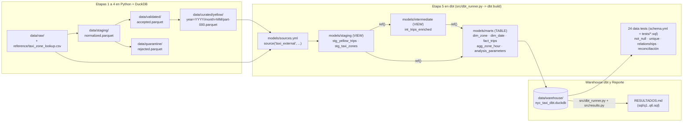
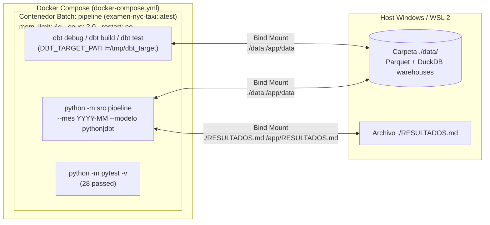

# Arquitectura Definitiva de Ingeniería de Datos — Pipeline NYC Taxi

Este documento describe la arquitectura implementada y verificada en el repositorio `examen_Taxis`. El proyecto integra dos modos de modelado dimensional seleccionables desde un único orquestador (`--modelo python` y `--modelo dbt`), infraestructura de contenedores reproducibles (**Docker / Docker Compose**) y automatización de pruebas mediante **GitHub Actions**.

---

## 1. Responsabilidad de Cada Tecnología (Sin Solapamientos)

Para evitar confusiones conceptuales frecuentes en la defensa oral, se define con precisión qué rol cumple cada componente:

| Componente | Qué es exactamente | Responsabilidad única en este proyecto | Qué NO es |
|---|---|---|---|
| **Python 3.12 (`src/`)** | Lenguaje de programación y plano de control del pipeline. | Orquestar las 5 etapas, descargar archivos en streaming HTTP con reintentos, calcular hashes SHA-256, validar el contrato YAML, invocar DuckDB o dbt y formatear `RESULTADOS.md`. | No procesa millones de filas en memoria (`pandas` no se usa). |
| **Apache Parquet (`data/`)** | Formato de almacenamiento columnar comprimido (`ZSTD`). | Persistir en disco las capas `raw`, `staging`, `validated`, `quarantine` y `curated` particionadas estilo Hive (`year=YYYY/month=MM`). | No es un motor de consultas ni una base de datos transaccional. |
| **DuckDB 1.4.3** | Motor SQL analítico columnar embebido (*in-process OLAP*). | Ejecutar todo el SQL pesado (normalización, reglas `R01`–`R08`, transformaciones, tablas del modelo estrella y las 6 consultas de negocio) con límite de `2 GB` de RAM y spill en `data/tmp`. | No es un servidor externo cliente-servidor como PostgreSQL. |
| **dbt Core + `dbt-duckdb`** | Framework declarativo de transformación y testing SQL/Jinja. | Compilar los modelos `staging`, `intermediate` y `marts` (`source()` y `ref()`), enviarlos a DuckDB para materializarlos en `nyc_taxi_dbt.duckdb` y ejecutar 24 pruebas de datos. | **No es un motor SQL ni una base de datos:** el motor que ejecuta el SQL compilado por dbt sigue siendo DuckDB. |
| **Docker / Docker Compose** | Plataforma de contenedores Linux sobre WSL 2. | Empaquetar Python 3.12, `git` y las librerías exactas de `requirements.txt` en una imagen reproducible (`examen-nyc-taxi:latest`) que monta `./data:/app/data`. | **No es una base de datos ni reemplaza a `.venv`:** es un contenedor batch efímero que se detiene al terminar la corrida. |
| **GitHub Actions** | Plataforma de Integración Continua (CI) en la nube. | Ejecutar en cada `push` o `pull_request` verificaciones livianas (`pip check`, `pytest -q`, `dbt parse` y `dbt compile`) sin descargar datasets grandes. | No ejecuta el pipeline sobre los Parquet reales de NYC TLC ni reemplaza las corridas locales. |

---

## 2. Principios Compartidos por Ambos Modos

Tanto la **Arquitectura 1** como la **Arquitectura 2** comparten íntegramente las primeras cuatro etapas ([`../src/ingest.py`](../src/ingest.py), [`../src/schema.py`](../src/schema.py), [`../src/quality.py`](../src/quality.py) y [`../src/transform.py`](../src/transform.py)):

1. **Inmutabilidad de `raw`:** los archivos `yellow_tripdata_YYYY-MM.parquet` y `taxi_zone_lookup.csv` se descargan de forma atómica (`.part`), se verifican con SHA-256 contra `data/control/ingestion_log.csv` y jamás se modifican.
2. **Contrato explícito ([`../contracts/yellow_schema.yaml`](../contracts/yellow_schema.yaml)):** normaliza las 20 columnas a `snake_case`, inyecta `cbd_congestion_fee = NULL::DOUBLE` antes de 2025 y falla ante columnas nuevas (`fail_and_report`).
3. **Compuerta de calidad y reconciliación (`R01`–`R08`):** separa cada fila en `accepted.parquet` (con `warning_flags`) o `rejected.parquet` (con `violated_rules` y `rejection_flags`), verificando dos veces que `rows_read == rows_accepted + rows_quarantined`.
4. **Transformación curada única:** [`../src/transform.py`](../src/transform.py) escribe `data/curated/yellow/year=YYYY/month=MM/part-000.parquet` con las columnas derivadas y el enriquecimiento geográfico. Ninguno de los dos motores vuelve a recalcular esa transformación pesada.
5. **Warehouses DuckDB independientes:** el modo Python escribe en `data/warehouse/nyc_taxi.duckdb` y el modo dbt escribe en `data/warehouse/nyc_taxi_dbt.duckdb`. Esto evita bloqueos de archivo, impide colisiones de catálogos y permite auditar que ambos caminos produzcan exactamente los mismos conteos y respuestas.

---

## 3. Arquitectura 1: Python + DuckDB + Parquet (`--modelo python`)

Es el modo predeterminado del orquestador:

```powershell
.\.venv\Scripts\python.exe -m src.pipeline --mes 2025-06
```

- **Funcionamiento de la Etapa 5:** [`../src/pipeline.py`](../src/pipeline.py) invoca `src.model.run_model(months)`.
- **Materialización en `data/warehouse/nyc_taxi.duckdb`:** [`../src/model.py`](../src/model.py) abre la conexión DuckDB con `memory_limit='2GB'`, `threads='2'`, `temp_directory='data/tmp'` y `preserve_insertion_order='false'`. Define una vista temporal `_curated` sobre los archivos `part-000.parquet` de los dos meses comparados y crea con `CREATE OR REPLACE TABLE` las tablas `dim_zone`, `dim_date`, `fact_trips` (con `row_number() OVER () AS trip_id`), `agg_zone_hour` y `analysis_parameters`.
- **Consultas de negocio:** ejecuta en orden los seis archivos de [`../sql/`](../sql/) (`q1_top_zones.sql` a `q6_month_variation.sql`) y delega en [`../src/results.py`](../src/results.py) la escritura de [`../RESULTADOS.md`](../RESULTADOS.md).

---

## 4. Arquitectura 2: Python + dbt + DuckDB + Parquet (`--modelo dbt`)

Se selecciona explícitamente pasando `--modelo dbt` al mismo orquestador:

```powershell
.\.venv\Scripts\python.exe -m src.pipeline --mes 2025-06 --modelo dbt
```



### 4.1. Cómo interactúan `src/dbt_runner.py`, `dbt` y DuckDB
1. **Parametrización dinámica (`--vars`):** [`../src/dbt_runner.py`](../src/dbt_runner.py) convierte la lista `months` (por ejemplo, `['2024-06', '2025-06']` o `['2024-05', '2025-05']`) en un diccionario JSON con `comparison_month`, `target_month`, `comparison_year`, `comparison_month_num`, `target_year` y `target_month_num`, y lanza `python -m dbt.cli.main build --no-partial-parse --vars ...`.
2. **Normalización de rutas POSIX para Windows y Linux:** `_dbt_environment()` exporta `NYC_TAXI_DATA_DIR`, `NYC_TAXI_DBT_WAREHOUSE` y `NYC_TAXI_DBT_TEMP` reemplazando barras invertidas (`\`) por barras POSIX (`/`), lo que evita problemas de secuencias de escape dentro de las cadenas Jinja de [`../dbt_project/models/sources.yml`](../dbt_project/models/sources.yml).
3. **Configuración en [`../dbt_project/profiles.yml`](../dbt_project/profiles.yml):** utiliza `config_options` (`memory_limit: "2GB"`, `threads: 1`, `temp_directory`, `preserve_insertion_order: false`) para que las opciones se apliquen una sola vez al abrir el archivo `nyc_taxi_dbt.duckdb` y no fallen entre cursores concurrentes.
4. **Capas del DAG de dbt (`32/32` tareas en `dbt build`):**
   - **3 vistas (`view`):** `stg_taxi_zones`, `stg_yellow_trips` e `int_trips_enriched`. Al ser vistas sobre Parquet, no duplican en disco los 7,49 millones de registros curados.
   - **5 tablas (`table`):** `analysis_parameters`, `dim_zone`, `dim_date`, `fact_trips` y `agg_zone_hour`.
   - **24 pruebas (`test`):** 21 tests genéricos de esquema en [`../dbt_project/models/schema.yml`](../dbt_project/models/schema.yml) y 3 tests singulares SQL en [`../dbt_project/tests/`](../dbt_project/tests/).

---

## 5. Comparación Sintética entre Arquitectura 1 y Arquitectura 2

| Dimensión | Arquitectura 1 (`--modelo python`) | Arquitectura 2 (`--modelo dbt`) |
|---|---|---|
| **Módulos de Etapas 1 a 4** | `ingest.py`, `schema.py`, `quality.py`, `transform.py` | Idénticos (compartidos) |
| **Módulo de Etapa 5** | [`../src/model.py`](../src/model.py) | [`../src/dbt_runner.py`](../src/dbt_runner.py) + [`../dbt_project/`](../dbt_project/) |
| **Base de datos DuckDB destino** | `data/warehouse/nyc_taxi.duckdb` (`527,51 MiB`) | `data/warehouse/nyc_taxi_dbt.duckdb` (`546,01 MiB`) |
| **Gestión de dependencias entre tablas** | Orden secuencial de sentencias SQL en Python | Grafo declarativo DAG resuelto por `source()` y `ref()` |
| **Pruebas de integridad del modelo** | `pytest` (28 tests) | `dbt test` (24 data tests en vivo) + `pytest` (28 tests) |
| **Tiempo total medido en `.venv` (Junio)** | `31,1 s` – `31,36 s` | `37,9 s` – `39,00 s` |
| **Pico de RAM observado en `.venv` (Junio)** | `~2.023 MB` | `~2.001 MB` |
| **Resultados de `sql/q1..q6.sql`** | Exactos | Equivalentes dentro de `1e-5` |

---

## 6. Infraestructura Contenedorizada (Docker Desktop / WSL 2 / Docker Compose)

La infraestructura de contenedores está definida en [`../Dockerfile`](../Dockerfile), [`../docker-compose.yml`](../docker-compose.yml) y [`../.dockerignore`](../.dockerignore), y documentada en [`DOCKER.md`](DOCKER.md):



- **Imagen liviana y limpia:** construida sobre `python:3.12-slim` con `git` y `requirements.txt`. Gracias a `.dockerignore`, no copia `data/` ni `.venv/`.
- **Aislamiento de artefactos temporales de dbt:** el contenedor define `DBT_TARGET_PATH=/tmp/dbt_target` y `DBT_LOG_PATH=/tmp/dbt_logs` para que la compilación interna en Linux no colisione con archivos generados desde Windows.
- **Presupuesto de memoria:** el contenedor fija `mem_limit: 4g` y DuckDB mantiene `memory_limit='2GB'`. En las corridas reales de junio (`7.862.153` filas leídas), `docker stats` registró un pico de **`1,851 GiB`** en modo Python (`45,16 s`) y **`1,872 GiB`** en modo dbt (`53,15 s`).

---

## 7. Automatización de Integración Continua (GitHub Actions)

El archivo [`../.github/workflows/tests.yml`](../.github/workflows/tests.yml) (explicado en [`CI.md`](CI.md)) automatiza la verificación del repositorio en cada `push` y `pull_request`:

1. Aprovisiona un entorno limpio `ubuntu-latest` con **Python 3.12**.
2. Instala [`../requirements.txt`](../requirements.txt) y ejecuta `python -m pip check`.
3. Corre `python -m pytest -q` (los **28 tests** unitarios y de integración sobre fixtures sintéticos).
4. Ejecuta `dbt parse` y `dbt compile` apuntando a directorios temporales del runner para verificar que el proyecto [`../dbt_project/`](../dbt_project/), sus macros Jinja, `sources.yml`, `schema.yml` y `profiles.yml` compilen sin errores antes de integrar cambios.
