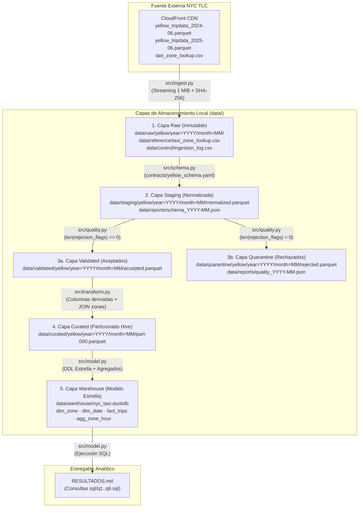
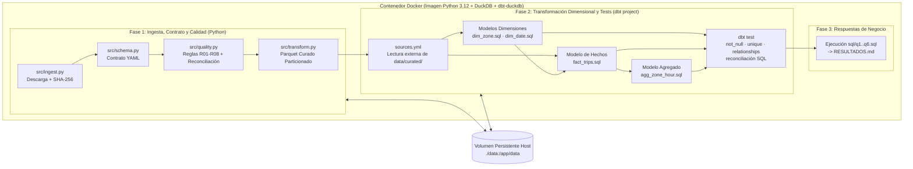

# Arquitectura de Ingeniería de Datos — Pipeline NYC Taxi

Este documento describe en profundidad las dos visiones arquitectónicas del proyecto:
1. **Arquitectura 1 — Implementada y verificada en este repositorio (`main`):** arquitectura batch local de bajo consumo de memoria basada en **Python 3.10+**, **DuckDB 1.4.3** y **Apache Parquet** particionado estilo Hive.
2. **Arquitectura 2 — Evolutiva / en preparación (`integration/dbt-prep`):** evolución hacia el ecosistema moderno de datos (*Modern Data Stack*) vista en los materiales prácticos de la cátedra, incorporando **dbt (`dbt-duckdb`)** para el modelado dimensional declarativo y **Docker / WSL 2** para la portabilidad del entorno.

> **Importante:** En el estado actual del repositorio, el flujo 100 % operativo y verificado mediante `python -m src.pipeline --mes 2025-06` y `pytest` corresponde a la **Arquitectura 1**. La **Arquitectura 2** se documenta como diseño de evolución e integración posterior para separar con total transparencia lo implementado de lo planificado.

---

## 1. Principios de Diseño Compartidos

Ambas arquitecturas responden a los mismos principios fundamentales de Ingeniería de Datos evaluados en la materia:

1. **Inmutabilidad de la fuente cruda (`raw`):** los archivos descargados desde NYC TLC nunca se editan ni sobrescriben. Cualquier reprocesamiento parte de los bytes originales verificados por hash SHA-256.
2. **Contrato de esquema explícito y versionado:** la estructura esperada no está dispersa en el código, sino declarada en [`../contracts/yellow_schema.yaml`](../contracts/yellow_schema.yaml).
3. **Compuerta de calidad sin pérdida silenciosa de filas:** ninguna fila se descarta con un `WHERE` silencioso. Todo registro leído de la fuente pasa a `validated` (aceptado) o a `quarantine` (rechazado con trazabilidad de reglas violadas), cumpliendo la invariante matemática:
   $$\text{filas leídas} = \text{filas aceptadas} + \text{filas en cuarentena}$$
4. **Idempotencia en todas las etapas:** ejecutar el pipeline $N$ veces para `--mes 2025-06` no vuelve a descargar archivos cuyos hashes coinciden, reemplaza atómicamente las particiones mensuales y produce exactamente los mismos conteos en el modelo estrella.
5. **Eficiencia bajo presupuesto estricto de hardware (8 GB RAM):** procesamiento columnar vectorizado *out-of-core* con DuckDB (`memory_limit='2GB'`, `threads='2'`, `temp_directory='data/tmp'`), sin cargar millones de filas en estructuras en memoria de Python.

---

## 2. Arquitectura 1: Pipeline Batch Local Python + DuckDB + Parquet (Implementada)

### 2.1. Visión general
En esta arquitectura, Python actúa como **orquestador liviano** ([`../src/pipeline.py`](../src/pipeline.py)) y delega todo el procesamiento pesado de datos al motor analítico embebido **DuckDB** ([`../src/config.py`](../src/config.py)). El almacenamiento intermedio entre etapas se materializa en archivos **Apache Parquet** comprimidos con `ZSTD`, mientras que la capa de presentación analítica reside en el archivo `data/warehouse/nyc_taxi.duckdb`.

### 2.2. Contratos de interfaz entre módulos Python
Tal como se documenta en [`../AGENTS.md`](../AGENTS.md), cada módulo expone una función con responsabilidad acotada:

| Etapa | Módulo | Firma de la función | Entrada | Salida |
|---|---|---|---|---|
| 1 | [`../src/ingest.py`](../src/ingest.py) | `run_ingest(month: str) -> Path` | Período `YYYY-MM` | Ruta al Parquet en `data/raw/` |
| 2 | [`../src/schema.py`](../src/schema.py) | `run_schema(month: str, raw_path: Path) -> Path` | Período y ruta `raw` | Ruta a `normalized.parquet` en `data/staging/` |
| 3 | [`../src/quality.py`](../src/quality.py) | `run_quality(month: str, staged_path: Path) -> Path` | Período y ruta `staging` | Ruta a `accepted.parquet` en `data/validated/` (y genera `rejected.parquet` + JSON) |
| 4 | [`../src/transform.py`](../src/transform.py) | `run_transform(month: str, validated_path: Path) -> Path` | Período y ruta `validated` | Ruta a `part-000.parquet` en `data/curated/` |
| 5 | [`../src/model.py`](../src/model.py) | `run_model(months: list[str]) -> None` | Lista `['2024-06', '2025-06']` | Tablas en `nyc_taxi.duckdb` y archivo [`../RESULTADOS.md`](../RESULTADOS.md) |

### 2.3. Decisiones clave de implementación en la Arquitectura 1
- **Publicación atómica de archivos (`copy_parquet` y `write_json` en [`../src/config.py`](../src/config.py)):** todas las escrituras se realizan primero sobre un archivo `.tmp` o `.part` en el mismo directorio y luego se ejecutan con `Path.replace(target)`. Si ocurre una excepción a mitad del proceso, el bloque `finally` limpia el archivo temporal y la versión previa permanece consistente.
- **Control explícito de `hive_partitioning=false`:** al leer un archivo Parquet individual dentro de `year=YYYY/month=MM/`, se desactiva la inferencia automática de columnas Hive en DuckDB para evitar que columnas `year` o `month` se inyecten inadvertidamente en el esquema del contrato o alteren la partición de `row_number() OVER (PARTITION BY ...)` en la regla `R07` (duplicados exactos).
- **Optimización de memoria en la construcción de `fact_trips`:** en lugar de duplicar las particiones curadas en una tabla física `_curated` dentro de DuckDB y ordenar globalmente los 7,49 millones de viajes, [`../src/model.py`](../src/model.py) define `CREATE OR REPLACE TEMP VIEW _curated` sobre los Parquet curados y proyecta `fact_trips` con `row_number() OVER () AS trip_id`. Esto mantiene el tamaño del archivo `nyc_taxi.duckdb` en ~531 MB y permite ejecutar las 5 etapas dentro del presupuesto de 2 GB de RAM.

---

## 3. Arquitectura 2: Evolución con dbt y Contenedores Docker (En preparación / Referencia)

### 3.1. Motivación académica y técnica
Durante el cursado de **Fundamentos de Datos** se estudiaron dos herramientas complementarias que resuelven desafíos habituales en equipos de ingeniería de datos de producción:
1. **Docker y WSL 2 (según la guía de clase *Ubuntu WSL + Conda + Docker*):** empaquetar el intérprete de Python, las bibliotecas nativas (`duckdb`, `pyarrow`) y las herramientas CLI dentro de una imagen contenedorizada elimina las diferencias entre sistemas operativos (Windows PowerShell vs Ubuntu Linux), rutas de ejecutables y versiones locales de Python.
2. **dbt (*data build tool*) con adaptador `dbt-duckdb` (según la guía práctica *Ingesta y modelado con dbt*):** separar las etapas de **Ingesta / Calidad física** (responsabilidad de Python) del **Modelado Dimensional y Tests de Datos** (responsabilidad declarativa de dbt en SQL/Jinja).

### 3.2. Diagrama de la Arquitectura 2 (Integración de dbt y Docker)

### 3.3. División de responsabilidades en la Arquitectura 2
Cuando se integran **dbt** y **Docker** sobre la base actual del proyecto:
- **Python (`src/ingest.py`, `src/schema.py`, `src/quality.py`, `src/transform.py`)** conserva el control imperativo de todo lo que SQL puro o dbt no están diseñados para hacer: descargas HTTP con reintentos exponenciales, validación criptográfica SHA-256, auditoría en `ingestion_log.csv`, validación preventiva contra `contracts/yellow_schema.yaml` y separación física en `accepted.parquet` / `rejected.parquet`.
- **dbt (`dbt_project/`)** reemplaza las sentencias DDL manuales (`CREATE OR REPLACE TABLE ...`) de `src/model.py` por modelos selectivos (`models/marts/dim_zone.sql`, `dim_date.sql`, `fact_trips.sql`, `agg_zone_hour.sql`) con grafo de linaje automático (DAG) y pruebas declarativas (`dbt test`: `unique`, `not_null`, `relationships`) sobre `nyc_taxi.duckdb`.
- **Docker (`Dockerfile` y `docker-compose.yml`)** monta la carpeta `./data` como volumen persistente (`/app/data`) y permite ejecutar todo el flujo con un comando único contenedorizado sin requerir la instalación manual de `.venv` en la máquina anfitriona.

---

## 4. Comparación Técnica entre Ambas Arquitecturas

| Dimensión de análisis | Arquitectura 1: Python + DuckDB + Parquet (Actual en `main`) | Arquitectura 2: Python + DuckDB + dbt + Docker (Evolutiva) |
|---|---|---|
| **Estado en el repositorio** | **100 % implementada, probada y verificada** | Documentada como evolución arquitectónica |
| **Comando de ejecución** | `python -m src.pipeline --mes 2025-06` / `make all MES=2025-06` | `docker compose run --rm pipeline --mes 2025-06` (con `dbt build` interno) |
| **Construcción del modelo estrella** | SQL ejecutado desde [`../src/model.py`](../src/model.py) (`CREATE OR REPLACE TABLE`) | Modelos declarativos `.sql` en `dbt` materializados en DuckDB (`dbt run` / `dbt build`) |
| **Validación de integridad del modelo** | Suite `pytest` ([`../tests/`](../tests/)) + doble reconciliación en [`../src/quality.py`](../src/quality.py) | Suite `pytest` + tests nativos de `dbt` (`unique`, `not_null`, `relationships`, tests singulares SQL) |
| **Aislamiento del entorno** | Entorno virtual Python (`.venv`) con versiones fijadas en [`../requirements.txt`](../requirements.txt) | Contenedor Docker reproducible en cualquier host con Docker Desktop / WSL 2 |
| **Consumo de recursos (RAM)** | **Muy bajo (~2,01 GB pico medido)**; sin sobrecarga de demonios ni contenedores adicionales | **Bajo-Moderado**; suma el consumo base del motor de contenedores (WSL 2 / Docker Engine) |
| **Complejidad operativa** | Mínima (5 paquetes en `requirements.txt`, ejecución nativa inmediata en Windows/Linux) | Media (requiere Docker Desktop activo y configuración de `profiles.yml` / `dbt_project.yml`) |

---

## 5. Conclusión Arquitectónica

La elección de construir y consolidar primero la **Arquitectura 1** responde directamente a una regla central de ingeniería de software: **garantizar primero la exactitud de los datos, la reconciliación matemática, la idempotencia y el cumplimiento del presupuesto de 8 GB de RAM con la menor complejidad accidental posible**.

Gracias al diseño desacoplado por capas en `data/` y a las interfaces limpias definidas en [`../AGENTS.md`](../AGENTS.md), la transición hacia la **Arquitectura 2** (sustituir el paso de modelado de `src/model.py` por un proyecto `dbt` y envolver la ejecución en un contenedor Docker) no requiere modificar ni una sola línea de las etapas de ingesta, esquema, calidad o cuarentena.
