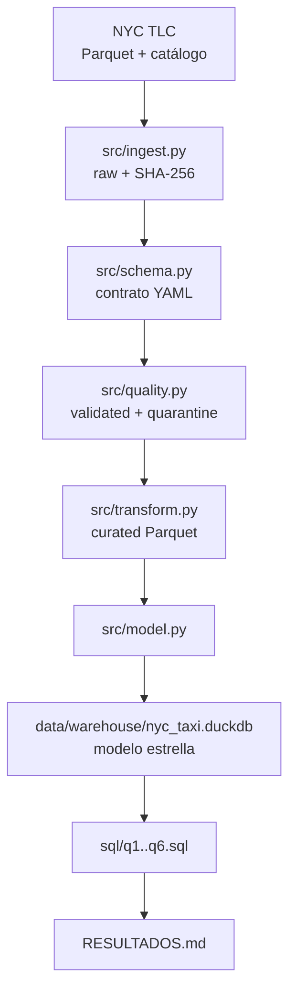
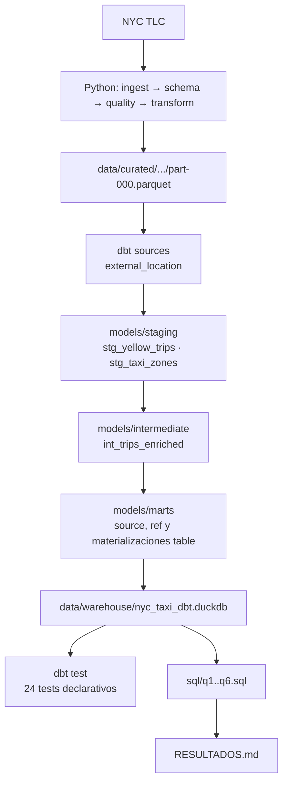

# Arquitectura de Ingeniería de Datos — Pipeline NYC Taxi

Este documento describe la arquitectura realmente implementada en la rama de integración. El proyecto conserva dos motores de modelado seleccionables desde el mismo orquestador: Python (predeterminado) y dbt. Ambos comparten las etapas de ingesta, contrato, calidad y transformación, pero escriben warehouses DuckDB independientes.

## 1. Principios y componentes compartidos

1. **Raw inmutable:** `src.ingest` descarga Parquet y CSV en streaming, calcula SHA-256 y reutiliza archivos cuyo hash coincide.
2. **Contrato explícito:** `src.schema` valida y normaliza contra [`../contracts/yellow_schema.yaml`](../contracts/yellow_schema.yaml).
3. **Calidad con trazabilidad:** `src.quality` clasifica cada fila en `validated` o `quarantine`, conserva banderas y verifica `leídas = aceptadas + cuarentena`.
4. **Transformación única:** `src.transform` produce `data/curated/yellow/year=YYYY/month=MM/part-000.parquet` con columnas derivadas y zonas enriquecidas.
5. **Recursos acotados:** DuckDB usa como máximo 2 GB, dos hilos en el pipeline Python, spill en `data/tmp` y nunca se cargan los millones de registros en pandas.
6. **Un constructor por corrida:** `src.pipeline` selecciona `src.model` o `src.dbt_runner`; nunca ejecuta ambos sobre el mismo proceso.

Las interfaces de las primeras cuatro etapas están definidas en [`../AGENTS.md`](../AGENTS.md): `run_ingest`, `run_schema`, `run_quality` y `run_transform`. El modelado Python conserva `run_model(months)` y el runner dbt expone la misma interfaz.

## 2. Arquitectura Python original

El comando predeterminado es:

```powershell
.\.venv\Scripts\python.exe -m src.pipeline --mes 2025-06
```

El modelo se materializa en `data/warehouse/nyc_taxi.duckdb` desde una vista temporal sobre los Parquet curados. [`src/model.py`](../src/model.py) crea `dim_zone`, `dim_date`, `fact_trips`, `agg_zone_hour` y `analysis_parameters`, y ejecuta [`../sql/`](../sql/) para producir `RESULTADOS.md`.



## 3. Arquitectura Python + dbt integrada

El modo alternativo se ejecuta con:

```powershell
.\.venv\Scripts\python.exe -m src.pipeline --mes 2025-06 --modelo dbt
```

`src.pipeline` mantiene las etapas Python hasta `curated`. Luego [`../src/dbt_runner.py`](../src/dbt_runner.py) pasa los dos períodos a `dbt build` mediante variables Jinja y ejecuta las consultas de negocio sobre el warehouse dbt. Las fuentes dbt (`models/sources.yml`) leen los Parquet curados y el catálogo real; no hay seeds ni fuentes sintéticas.



### 3.1. Modelos dbt y dependencias

- **Staging:** `stg_yellow_trips` une los dos períodos curados y `stg_taxi_zones` tipa el catálogo.
- **Intermediate:** `int_trips_enriched` expone la capa curada como vista; la transformación pesada ya fue realizada una sola vez por `src.transform`.
- **Marts:** `fact_trips`, `dim_date`, `dim_zone`, `agg_zone_hour` y `analysis_parameters` se materializan como tablas.
- **`source()`:** conecta los modelos con los Parquet aceptados/curados y el catálogo real.
- **`ref()`:** construye el DAG entre staging, intermediate y marts y evita dependencias implícitas.
- **`dbt build`:** compila, materializa y ejecuta los tests asociados en orden de dependencia.

El período no está fijado en junio de 2025: `src.dbt_runner` pasa `comparison_month`, `target_month`, años y números de mes a cada ejecución.

## 4. Qué se comparte y qué cambia

| Aspecto | Compartido | Modo Python | Modo dbt |
|---|---|---|---|
| Ingesta, esquema, calidad, cuarentena | Sí | `src/ingest.py`, `schema.py`, `quality.py` | Igual |
| Transformación curada | Sí | `src/transform.py` | Igual; dbt consume sus Parquet |
| Constructor del modelo | No | `src/model.py` | `src/dbt_runner.py` → `dbt build` |
| Warehouse | No | `data/warehouse/nyc_taxi.duckdb` | `data/warehouse/nyc_taxi_dbt.duckdb` |
| Tests de modelado | No | pytest e integración SQL | 24 tests dbt + pytest |
| Consultas q1–q6 | Sí | Ejecutadas por `src.model` | Ejecutadas por `src.dbt_runner` |

La separación de archivos DuckDB evita bloqueos y permite comparar ambos resultados. No se ejecutan dos constructores simultáneamente ni se crea una segunda copia de la transformación dentro del modo dbt: staging e intermediate son vistas sobre `curated`; sólo los marts requeridos son tablas.

## 5. Modelo estrella y reconciliación

Ambos warehouses presentan la misma granularidad:

| Relación | Filas verificadas | Regla |
|---|---:|---|
| `fact_trips` | 7.493.698 | `trip_id` único; 3.441.465 de 2024-06 y 4.052.233 de 2025-06 |
| `dim_zone` | 265 | Claves TLC completas, incluidos 264 y 265 |
| `dim_date` | 60 | Fechas de subida de ambos meses |
| `agg_zone_hour` | 210.698 | `SUM(trips) = 7.493.698` |

Las seis consultas SQL devuelven las mismas filas entre ambos warehouses, con diferencias sólo de redondeo de punto flotante inferiores a `1e-5`.

## 6. Memoria, tiempo y disco

Las mediciones se realizaron sobre los procesos completos (proceso Python y, en modo dbt, su proceso hijo):

| Modo | Tiempo | Pico RSS/Working Set del árbol | Warehouse |
|---|---:|---:|---:|
| Python | 31,36 s | 2.023 MB | 532,26 MiB |
| dbt | 39,00 s | 2.001 MB | 538,26 MiB |

El límite de DuckDB es 2 GB con spill a `data/tmp`. dbt utiliza `threads: 1` porque `dbt-duckdb` comparte el entorno local y cambiar `temp_directory` entre cursores con concurrencia producía un error; continúa dentro del máximo de dos hilos del proyecto. El pico RSS no es el consumo total de Windows.

## 7. Tecnologías pendientes

Docker, Docker Compose, Dagster y monitoreo externo **no están implementados** en esta rama. Son posibles extensiones posteriores; no forman parte de los resultados verificados del examen actual.
