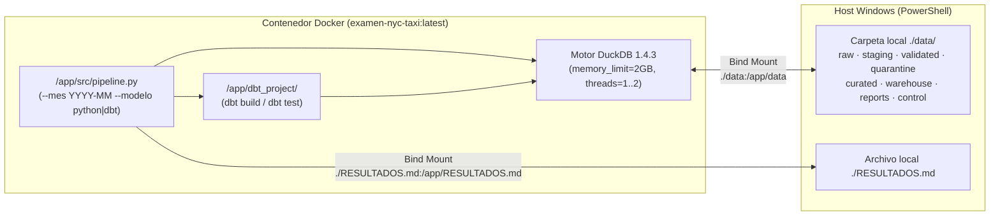

# Ejecución del Pipeline NYC Taxi con Docker y Docker Compose

Este documento explica los conceptos fundamentales de Docker aplicados a este proyecto (siguiendo el material de la cátedra **Fundamentos de Datos**) y detalla los comandos exactos para Windows PowerShell.

---

## 1. ¿Para qué usamos Docker en este proyecto?

En Ingeniería de Datos es frecuente que un pipeline funcione en la computadora de quien lo programó pero falle en otra máquina por diferencias en la versión de Python (`3.10`, `3.11`, `3.12`), paquetes compilados (`duckdb`, `pyarrow`), configuración de variables de entorno o rutas entre Windows y Linux.

Usamos **Docker** para empaquetar dentro de un entorno Linux liviano y estandarizado:
- El intérprete **Python 3.12** (`python:3.12-slim`).
- Todas las bibliotecas exactas de [`../requirements.txt`](../requirements.txt) (`duckdb==1.4.3`, `pyarrow==22.0.0`, `PyYAML==6.0.3`, `requests==2.32.5`, `pytest==9.0.2`, `dbt-core==1.12.7`, `dbt-duckdb==1.11.1`).
- El código fuente del pipeline ([`../src/`](../src/)), el contrato de esquema ([`../contracts/yellow_schema.yaml`](../contracts/yellow_schema.yaml)), las consultas ([`../sql/`](../sql/)) y el proyecto dbt ([`../dbt_project/`](../dbt_project/)).

De esta manera, cualquier integrante o docente puede ejecutar exactamente el mismo entorno sin instalar ni configurar paquetes manualmente en su sistema operativo anfitrión, conservando además la posibilidad de correr el proyecto de forma nativa con `.venv`.

---

## 2. Diferencia entre Imagen y Contenedor

Siguiendo la guía de clase:

| Concepto | Qué es | Cómo se ve en nuestro proyecto |
|---|---|---|
| **Imagen (`Image`)** | Es una **plantilla inmutable de solo lectura** construida a partir del [`../Dockerfile`](../Dockerfile). Contiene el sistema base Linux Debian slim, Python 3.12, las librerías instaladas y el código del proyecto, pero **no incluye los datos (`data/`)** gracias a [`../.dockerignore`](../.dockerignore). | La imagen se llama `examen-nyc-taxi:latest` y se crea con `docker compose build`. |
| **Contenedor (`Container`)** | Es una **instancia en ejecución** (o detenida) creada a partir de la imagen. En nuestro caso es un contenedor **batch** (efímero): arranca, ejecuta la tarea solicitada (`pytest`, `src.pipeline` o `dbt`), escribe los resultados en el volumen compartido y se detiene automáticamente al terminar, liberando la memoria RAM. | Se lanza bajo demanda con `docker compose run --rm pipeline ...`. |

---

## 3. ¿Qué hace Docker Compose?

Mientras que el [`../Dockerfile`](../Dockerfile) define **cómo se construye la imagen**, el archivo [`../docker-compose.yml`](../docker-compose.yml) define **cómo se ejecuta el servicio `pipeline`**:

1. **Variables de entorno preconfiguradas:** define `NYC_TAXI_DATA_DIR=/app/data`, `NYC_TAXI_DBT_WAREHOUSE=/app/data/warehouse/nyc_taxi_dbt.duckdb`, `NYC_TAXI_DBT_TEMP=/app/data/tmp` y ubica los artefactos efímeros de compilación/logs de dbt en `/tmp/dbt_target` y `/tmp/dbt_logs` dentro del contenedor para no ensuciar el repositorio ni provocar choques de rutas entre Windows y Linux.
2. **Montaje de volúmenes persistentes (`volumes`):** conecta la carpeta `./data` de Windows con `/app/data` dentro del contenedor y el archivo `./RESULTADOS.md` con `/app/RESULTADOS.md`.
3. **Límites de recursos para notebooks de 8 GB de RAM:** establece `mem_limit: 4g`, `cpus: 2.0` y `restart: "no"`, asegurando que el contenedor no consuma toda la memoria del equipo ni quede corriendo en bucle en segundo plano.



---

## 4. Cómo se utilizan los Volúmenes y por qué `raw` sigue siendo inmutable

En [`../docker-compose.yml`](../docker-compose.yml) utilizamos dos *bind mounts*:
- `./data:/app/data`
- `./RESULTADOS.md:/app/RESULTADOS.md`

Esto garantiza tres propiedades esenciales:
1. **La imagen Docker es liviana:** [`../.dockerignore`](../.dockerignore) excluye `data/` y `.venv/`. Los cientos de megabytes de archivos Parquet y bases DuckDB no se copian dentro de la imagen durante el `build`.
2. **Reutilización sin re-descarga e inmutabilidad de `raw`:** cuando el contenedor arranca y ve que `data/raw/yellow/year=2025/month=06/yellow_tripdata_2025-06.parquet` ya existe en la carpeta `./data` del host, [`../src/ingest.py`](../src/ingest.py) calcula su hash SHA-256, comprueba que coincide con `data/control/ingestion_log.csv` y lo reutiliza (`action=reused`) sin volver a descargarlo ni modificarlo.
3. **Persistencia e independencia de warehouses:** cuando el contenedor se destruye (`--rm` o `docker compose down`), todos los Parquet (`staging`, `validated`, `quarantine`, `curated`), los reportes JSON y ambos warehouses (`data/warehouse/nyc_taxi.duckdb` para el modo Python y `data/warehouse/nyc_taxi_dbt.duckdb` para el modo dbt) permanecen intactos en la carpeta `data/` de Windows.

---

## 5. Comandos Exactos en Windows PowerShell

Todos los comandos se ejecutan desde la raíz del repositorio en **PowerShell** y no requieren tener instalado GNU Make (`make`).

### 5.1. Validar la configuración y construir la imagen
```powershell
docker compose config
docker compose build
```

### 5.2. Ejecutar la suite completa de tests (`pytest`) dentro del contenedor
```powershell
docker compose run --rm pipeline python -m pytest -v
```

### 5.3. Verificar la conexión y configuración de `dbt` (`dbt debug` y `dbt build`)
```powershell
docker compose run --rm pipeline dbt debug --project-dir /app/dbt_project --profiles-dir /app/dbt_project
```

Para correr `dbt build` directamente sobre los datos ya procesados de `2024-06` y `2025-06`:
```powershell
docker compose run --rm pipeline dbt build --project-dir /app/dbt_project --profiles-dir /app/dbt_project
```

### 5.4. Ejecutar el pipeline completo en modo Python (`nyc_taxi.duckdb`)
Usa el comando por defecto configurado en `docker-compose.yml` (`--mes 2025-06` con `--modelo python`):
```powershell
docker compose run --rm pipeline
```
O de forma explícita:
```powershell
docker compose run --rm pipeline python -m src.pipeline --mes 2025-06 --modelo python
```

### 5.5. Ejecutar el pipeline completo en modo dbt (`nyc_taxi_dbt.duckdb`)
Ejecuta ingesta, esquema, calidad, transformación curada, construye y testea los modelos con `dbt build` y genera `RESULTADOS.md`:
```powershell
docker compose run --rm pipeline python -m src.pipeline --mes 2025-06 --modelo dbt
```

### 5.6. Cambiar el mes a procesar (`--mes YYYY-MM`)
El pipeline acepta cualquier período publicado por NYC TLC (por ejemplo `2025-05`, que compara automáticamente mayo de 2024 contra mayo de 2025), tanto en modo Python como en modo dbt:

```powershell
# Mayo 2025 vs Mayo 2024 con motor Python
docker compose run --rm pipeline python -m src.pipeline --mes 2025-05 --modelo python

# Mayo 2025 vs Mayo 2024 con motor dbt
docker compose run --rm pipeline python -m src.pipeline --mes 2025-05 --modelo dbt
```

### 5.7. Cómo observar los logs del contenedor
- Al usar `docker compose run --rm pipeline ...`, todos los logs de Python, DuckDB y dbt se muestran **en vivo por salida estándar** en PowerShell.
- Si se ejecuta el servicio con `docker compose up` (sin `--rm`), el contenedor queda registrado al finalizar y sus logs pueden consultarse en cualquier momento con:
  ```powershell
  docker compose up
  docker compose logs --tail 100 pipeline
  ```

### 5.8. Cómo detener y limpiar contenedores sin perder los datos
Para eliminar contenedores detenidos y la red virtual de Compose conservando intactos todos los archivos de `./data` y `./RESULTADOS.md`:
```powershell
docker compose down --remove-orphans
```
*(Nunca hace falta borrar `./data`; `docker compose down` sólo limpia recursos efímeros de Docker).*

---

## 6. Ventajas y Limitaciones en una Computadora con 8 GB de RAM

### Ventajas
- **Reproducibilidad total:** elimina problemas de instalación de `dbt-core`, `dbt-duckdb`, `duckdb` o `pyarrow` entre distintas máquinas Windows/Linux.
- **Ejecución por lotes (*batch*) sin consumo ocioso:** al no incluir servicios residentes pesados (como bases de datos cliente-servidor o paneles web permanentes) y tener `restart: "no"`, el contenedor consume `0 MB` de RAM apenas termina el comando.
- **Tope de memoria en dos niveles (límites configurados vs. consumos observados):**
  1. **Límites configurados:** DuckDB tiene configurado `memory_limit='2GB'` y `threads='2'` (en Python) / `threads=1` (en dbt) volcando temporales a `/app/data/tmp`; Docker Compose fija `mem_limit: 4g` y `cpus: 2.0` como techo del contenedor.
  2. **Consumos reales observados (`docker stats`):** durante el procesamiento real de los 7,86 millones de viajes de `2024-06` y `2025-06`, el contenedor alcanzó un pico de **`1,851 GiB`** en modo `python` (duración **`45,16 s`**) y **`1,872 GiB`** en modo `dbt` (duración **`53,15 s`**, incluyendo `dbt build` 32/32 en ~`18,2 s`), manteniéndose siempre por debajo de los 2 GB de DuckDB y de los 4 GB asignados al contenedor.

### Limitaciones y cuidados en equipos de 8 GB
- **Consumo base de Docker Desktop / WSL 2 (`vmmemWSL`):** en Windows, tener Docker Desktop abierto inicia una máquina virtual ligera de Linux en WSL 2 que consume entre ~1 GB y ~2 GB de RAM del sistema operativo anfitrión. Por eso, en una notebook de 8 GB conviene cerrar navegadores pesados durante la corrida o apagar Docker Desktop al terminar de trabajar.
- **Un único pipeline activo a la vez:** tanto si se ejecuta desde Docker como desde el entorno virtual local `.venv`, no se deben correr dos procesos simultáneos sobre la misma carpeta `./data`, ya que DuckDB bloquea el archivo `.duckdb` durante la escritura para garantizar consistencia transaccional.
- **Convivencia con la ejecución local:** la configuración de Docker no altera ningún archivo de código ni reemplaza a `.venv`. Si en una computadora con poca memoria libre se prefiere no abrir Docker Desktop, el comando local `.\.venv\Scripts\python.exe -m src.pipeline --mes 2025-06 --modelo dbt` sigue funcionando de manera idéntica.
